# NOVA-ELF

**A structured object format for SUBLEQ microcode, machine images, and verifiable binary transformations.**

NOVA-ELF packages the machine image of a word-addressed SUBLEQ virtual machine into a structured ELF64 relocatable object. The object carries the machine's instructions and initial memory, the constants and lookup tables the program needs, microprogram metadata for an outer ROM controller, a record of which encoding produced the artifact, proof-related evidence, and the transformation lineage that connects the artifact to the specification it was lowered from. A dedicated loader reads the object back and reconstructs the machine image byte for byte. The format is verified by execution: the codec family is bijective, the loader preserves the image, and the image reconstructed from ELF computes GF(2^8) multiplication correctly for all 65,536 input pairs.

This document is the complete technical manual for the format. It explains the SUBLEQ machine from its transition function up, the ELF64 container field by field, every custom section, the packaging pipeline, the encoding family, the Racket API, the verification contract and how to reproduce it, and the boundary between this repository and the NovaDag provenance system that records the artifact. Everything stated here is grounded in the source code in this repository: `elf/elf.rkt`, `elf/codec.rkt`, `elf/package.rkt`, and `elf/verify.rkt`, together with the shipped artifact in `artifact/`. Where a claim comes from an earlier measurement rather than from a check run against the current tree, the text says so.

## Contents

- [What NOVA-ELF is](#what-nova-elf-is)
- [What problem it solves](#what-problem-it-solves)
- [Quick start](#quick-start)
- [End-to-end example](#end-to-end-example)
- [System architecture](#system-architecture)
- [The SUBLEQ machine model](#the-subleq-machine-model)
- [Formal machine semantics](#formal-machine-semantics)
- [Worked examples](#worked-examples)
- [Memory representation](#memory-representation)
- [The ELF64 container](#the-elf64-container)
- [Custom section reference](#custom-section-reference)
- [Object construction](#object-construction)
- [Loader and parser](#loader-and-parser)
- [Packaging pipeline](#packaging-pipeline)
- [Microprogram metadata: .nova.urom](#microprogram-metadata-novaurom)
- [The NOVA encoding family](#the-nova-encoding-family)
- [ROMHEX](#romhex)
- [Racket API reference](#racket-api-reference)
- [Detailed usage examples](#detailed-usage-examples)
- [Binary inspection](#binary-inspection)
- [Verification contracts](#verification-contracts)
- [Reproducing the project checks](#reproducing-the-project-checks)
- [Proof and provenance representation](#proof-and-provenance-representation)
- [Relationship to NovaDag](#relationship-to-novodag)
- [Error handling](#error-handling)
- [Security considerations](#security-considerations)
- [Interoperability](#interoperability)
- [Format extensibility and compatibility](#format-extensibility-and-compatibility)
- [Repository layout](#repository-layout)
- [Architectural tradeoffs](#architectural-tradeoffs)
- [Developer guide](#developer-guide)
- [Troubleshooting](#troubleshooting)
- [Glossary](#glossary)
- [License and acknowledgments](#license-and-acknowledgments)

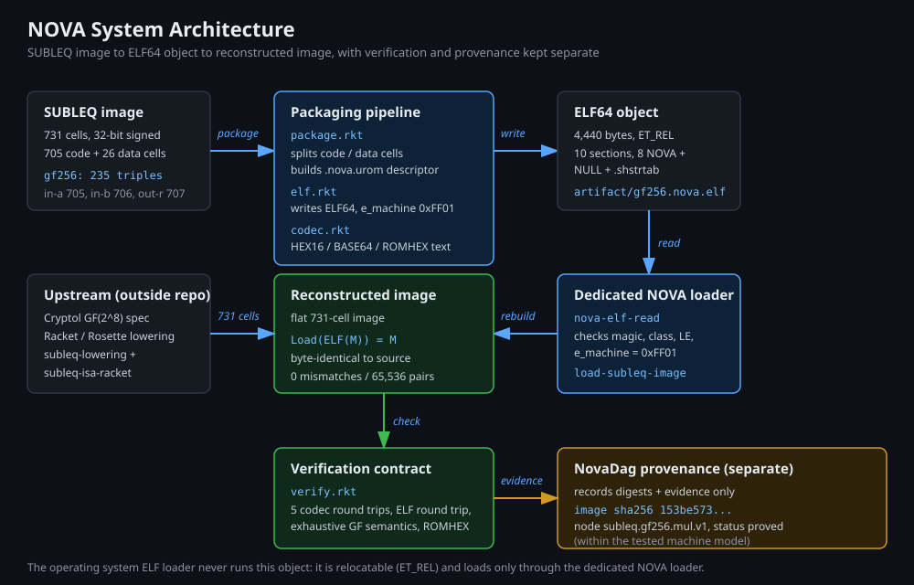

## What NOVA-ELF is

NOVA-ELF is a binary object format. It takes a flat array of signed 32-bit words — the complete memory image of a SUBLEQ machine program — and stores it inside an ELF64 file with enough structure that a loader can recover the image exactly, a reader can tell which program it is and where it came from, and a verifier can check that nothing was lost in the round trip.

The format has four parts that work together:

1. **The machine.** A SUBLEQ (subtract and branch if less or equal) virtual machine with one instruction, 65,536 word-addressed memory cells, and a 32-bit signed word. The machine itself lives outside this repository, in the `subleq-isa-racket` tree, but this manual documents its semantics completely because the format exists to carry its images.
2. **The container.** A standard ELF64 relocatable object (`ET_REL`) with a custom machine identifier, `e_machine = 0xFF01`, and eight custom sections under the `.nova.*` and `.note.nova` names. The container is 64-bit ELF; the machine it carries is 32-bit. Those two widths are different things, and confusing them is the most common misunderstanding this document has to prevent.
3. **The encodings.** Six reversible base encodings — NOVA-HEX16, NOVA-BASE32, NOVA-BASE64, NOVA-BASE256, NOVA-BASE512, and NOVA-ROMHEX — for moving the binary object or the machine image through text channels, storage, and ROM initialization. Every one of them is bijective over its supported inputs, and none of them is encryption.
4. **The verification contract.** A set of checks, run by execution in `elf/verify.rkt`, that establish the properties the format promises: codec bijectivity, image preservation through the ELF round trip, exhaustive functional correctness of the packaged program, and ROMHEX round-trip preservation.

The shipped instance of the format is the v1 artifact for the GF(2^8) multiplication program: a 731-cell SUBLEQ image packaged as a 4,440-byte ELF file, with text encodings and a ROM initialization file alongside it, all in `artifact/`.

## What problem it solves

A SUBLEQ program is, at its most reduced, a list of numbers. That list is the whole program: code, data, and constants share one flat address space, and there is no syntax left once the assembler has run. A bare list of numbers is hard to store, hard to identify, hard to check, and hard to load into hardware. If you hand someone 731 integers, they cannot tell which ones are instructions and which are data, which program it is, what it was lowered from, whether it has been corrupted, or how to put it into a ROM.

NOVA-ELF solves the storage and identification problem without changing the program. It wraps the flat image in a container that separates code from data, records the machine's word width and entry point, carries the constants the program needs, attaches the digest that identifies the image, records the evidence that the image was checked, and records the lineage that connects it to its specification. The loader reverses the wrapping exactly: `Load(ELF(M)) = M`, the image that comes out is the image that went in, byte for byte. Because the identity of the image is a SHA-256 digest over the canonical binary image rather than over any textual encoding, the same program keeps the same identity no matter which encoding carries it.

The format also solves a separation problem. The lowering compiler, the verification engine, the DAG provenance system, and the hardware loader are four different responsibilities, and they belong in four different places. NOVA-ELF is the serialization boundary between them: the compiler produces an image, this format packages it, the verifier checks the package, the DAG records the evidence, and the hardware loader consumes the ROM file. No one of those systems needs to understand the internals of the others; they only need to agree on the object format documented here.

### Why ELF64

ELF is the established object format for relocatable machine code, and reusing it buys three things. First, the header, section table, and string table machinery already exists, so the format does not need to invent its own framing, alignment, or metadata conventions. Second, ordinary binary tools — `readelf`, `objdump`, `xxd`, hex editors — can open a NOVA-ELF file, parse its header, list its sections, and dump its contents without any custom tooling, because the file is a well-formed ELF64 object. Third, the section model maps cleanly onto the problem: code goes in one section, data in another, constants in a third, and metadata in sections of their own, each with its own type, flags, and alignment.

ELF64 specifically, rather than ELF32, is used because the 64-bit header is the modern default and because the container width has nothing to do with the target machine width. The ELF header fields are 64-bit because ELF64 says so; the SUBLEQ words stored in the sections are 32-bit because the SUBLEQ ABI says so. A 64-bit container carrying 32-bit words is not a contradiction, any more than a 64-bit filesystem carrying 32-bit integers is. The version note in `.note.nova` records the ABI explicitly — `word=32-bit signed LE` — so that no reader has to guess which width the payload uses.

There is one deliberate break from standard ELF practice: the machine identifier. `e_machine = 0xFF01` is in the processor-specific reserved range, unregistered, and valid for v1 only. It tells any reader that this is not an object for any real processor, and that only the dedicated NOVA loader should interpret it. The object is relocatable (`ET_REL`), has no program headers, has entry address 0, and must never be executed as a native Linux binary. The operating system's ELF loader and the NOVA loader are different programs with different jobs, and this format is built for the second one.

### What the SUBLEQ machine does

The SUBLEQ machine is a one-instruction computer. Its entire instruction set is a single operation: subtract the contents of one memory cell from another, and branch if the result is less than or equal to zero. Every program is a sequence of triples `(a, b, c)` stored in memory, and the machine executes them one at a time:

```
mem[b] <- mem[b] - mem[a]
if mem[b] <= 0 then pc <- c else pc <- pc + 3
```

That is the whole computer. There is no add instruction, no load instruction, no jump instruction — subtraction and conditional branching, composed, are enough to compute anything computable. The machine in this project has 65,536 memory cells, each holding an exact integer in the reference implementation, with a 32-bit signed word as the serialization width. Code and data live in the same memory: the program's instructions occupy the low cells and its data the cells after them, and the machine fetches its next instruction from memory exactly the way it reads its data. The machine halts when the program counter leaves the address range `[0, 65535]`; there is no HALT opcode. The full semantics, including the error and fuel conditions, are in [Formal machine semantics](#formal-machine-semantics).

### What developers can build or inspect

With this repository, a developer can:

- **Inspect the format.** Read `artifact/gf256.nova.elf` with any ELF tool, or with the Racket reader, and see exactly how a SUBLEQ image is laid out as sections. The [Binary inspection](#binary-inspection) chapter gives the commands.
- **Package a new image.** Call `package-subleq-image` on any 731-cell image (or adapt the 705/26 split for a different image) and get a NOVA-ELF object back. The [Packaging pipeline](#packaging-pipeline) and [Racket API reference](#racket-api-reference) chapters give the interface.
- **Load an object.** Call `load-subleq-image` on ELF bytes and get the flat image back, or call `nova-elf-read` for the full section map.
- **Encode and decode.** Use any of the six codecs to move binary data through text, and verify the round trip.
- **Reproduce the verification.** Run `elf/verify.rkt` and watch all eleven checks pass, including the exhaustive 65,536-pair functional check on the ELF-loaded image.
- **Implement a compatible loader.** Everything needed is in this manual: the header layout, the section table, the section contents, the byte order, and the reconstruction rule. The [Loader and parser](#loader-and-parser) chapter and the [Format extensibility](#format-extensibility-and-compatibility) chapter are written for that reader.
- **Build the next stage.** The ROMHEX artifact is the direct input to a VHDL ROM loader that puts the image into hardware memory. The format stops at the ROM file; the hardware is a separate project with its own pending proof obligation.

## Quick start

### Prerequisites

- **Racket v8.15.** The code is written in `#lang racket` and uses only the standard distribution plus `net/base64`, which ships with Racket. The verification run in this manual was performed with Racket v8.15 `[cs]` from `~/workspace/.tools/racket/bin/racket`. No other Racket version has been tested against this tree; the code uses no version-specific features beyond the base language, but v8.15 is the version the results below were produced with.
- **The sibling trees.** `elf/package.rkt` and `elf/verify.rkt` require two modules that live outside this repository: `../subleq-isa-racket/subleq/machine.rkt` and `../subleq-isa-racket/subleq/asm.rkt` (the SUBLEQ machine and assembler), and `../subleq-lowering/gf256.rkt` (the lowering engine that produces the 731-cell image). These are relative requires from `elf/`, so they resolve to `subleq-isa-racket/` and `subleq-lowering/` inside the repository root. A bare clone of this repository does not contain them, and `racket elf/verify.rkt` fails on the missing module in that case. See [Reproducing the project checks](#reproducing-the-project-checks) for the exact layout and the workaround used for the reproduction in this manual. `elf/elf.rkt` and `elf/codec.rkt` have no external requires beyond `net/base64` and load standalone.
- **A Unix shell and standard tools** for the inspection steps: `sha256sum`, `xxd` or `od`, and optionally `readelf` for cross-checking the ELF header.

### Layout

```
nova-elf/
  LICENSE                 SNAPKITTY OPAQUE SOURCE LICENSE v1.0
  README.md               this manual
  STATUS.md               verification scope and open items, as plain facts
  artifact/               shipped v1 outputs for the 731-cell image
    gf256.nova.elf        the NOVA-ELF object, 4,440 bytes
    gf256.nova.romhex     ROM initialization, 731 lines
    gf256.nova.hex16      HEX16 encoding of the ELF, 8,880 bytes
    gf256.nova.b64        BASE64 encoding of the ELF, 5,920 bytes
    manifest.json         digests, sizes, lineage, proof summary
  elf/                    Racket source
    elf.rkt               NOVA-ELF v1 writer and parser
    codec.rkt             the six base encodings
    package.rkt           image to ELF and ELF to image
    verify.rkt            the verification contract, run by execution
  docs/
    svg/                  the five architecture diagrams in this manual
```

### Run the verification contract

From the repository root, with the sibling trees in place:

```
racket elf/verify.rkt
```

Expected output, reproduced 2026-11-20 (Racket v8.15, ~13.5 seconds):

```
ok HEX16 bijective
ok BASE32 bijective
ok BASE64 bijective
ok BASE256 bijective
ok BASE512 bijective
ELF file size = 4440 bytes
ok ELF loader preserves image
ok ELF via HEX16
ok ELF via BASE64
ok ELF via BASE32
GF from ELF-loaded image: mismatches = 0 / 65536
ok GF semantics preserved through ELF
ok ROMHEX round-trip
ROMHEX lines = 731
artifacts written to artifact/
```

Each `ok` line is a check that passed; the script raises an error and stops on the first failure. The run rewrites the four artifacts in `artifact/`; the regenerated files are byte-identical to the shipped ones (same SHA-256 digests), which is itself a reproducibility check. `manifest.json` is not rewritten by the script — it was authored alongside the artifacts and records their digests.

### Inspect the shipped object

```
sha256sum artifact/gf256.nova.elf
```

gives `4c2605a56c05fab29b5f80e6244a84791b5db7a2021511203c0b6d6b4b79057f`, matching `STATUS.md` and `manifest.json`. The first line of the ROM file:

```
00000000 000002c6
```

is word address 0 holding the value `0x2c6` (710). The full binary layout is mapped in [The ELF64 container](#the-elf64-container).

## End-to-end example

This section walks the whole system once, from a SUBLEQ image to a verified artifact and back, using the actual code paths. Each step names the function that performs it and the file that defines it.

**Step 1 — the image.** The lowering engine produces a flat list of 731 exact integers: 705 code cells (235 SUBLEQ triples) followed by 26 data cells. The image is the program. Its identity is the SHA-256 digest of the canonical binary form — the 731 cells serialized as 32-bit signed little-endian words, 2,924 bytes — which is `153be573ab87f6a62f9c102cef88ee1a4e0ccfb501115c5e0ed0f8fa454ca673`. The labels `in-a`, `in-b`, and `out-r` sit at word addresses 705, 706, and 707: the two input cells and the output cell of the multiplication.

**Step 2 — packaging.** `package-subleq-image` (`elf/package.rkt`) splits the image at cell 705 into code and data, serializes each half to bytes, builds the `.nova.urom` descriptor (version, the 32-byte manifest digest, and four dispatch words), and hands eight section descriptions to `nova-elf-write` (`elf/elf.rkt`). The writer lays out a 64-byte ELF header, the section contents, and a 10-entry section header table, and returns 4,440 bytes.

**Step 3 — text encodings.** The same 4,440 bytes are encoded as HEX16 (8,880 characters) and BASE64 (5,920 characters) for transport, and the 731-cell image is separately encoded as ROMHEX (731 lines, one word per line) for ROM initialization. The encodings change the representation; they do not change the identity, which stays the image digest.

**Step 4 — loading.** `load-subleq-image` (`elf/package.rkt`) calls `nova-elf-read` (`elf/elf.rkt`), which validates the ELF magic, the 64-bit class, the little-endian data encoding, and the machine identifier `0xFF01`, then reads the section headers, resolves the section names through `.shstrtab`, and returns the section contents. The loader concatenates `.nova.text` and `.nova.data`, converts the bytes back to 32-bit signed words, and returns the flat 731-cell image. The check `Load(ELF(M)) = M` compares the reconstructed image with the original, cell for cell.

**Step 5 — behavioral verification.** The reconstructed image is loaded into a fresh SUBLEQ machine once per input pair, for all 65,536 pairs `(a, b)` with `a` and `b` ranging over 0..255. Each run must halt, and the value at `out-r` must equal the reference `gf-mul-ref` for that pair. The result is 0 mismatches. This is the strongest check in the contract: it does not merely confirm that the bytes survived the round trip, it confirms that the program that comes out of the ELF file still computes.

**Step 6 — provenance.** `manifest.json` records the image digest, the ELF digest, the encoding digests, the exhaustive result, the Rosette proof results from the lowering engine, and the DAG node identity. NovaDag ingests that manifest as evidence for node `subleq.gf256.mul.v1`. The format tooling does not create the DAG record; it produces the evidence the DAG records.

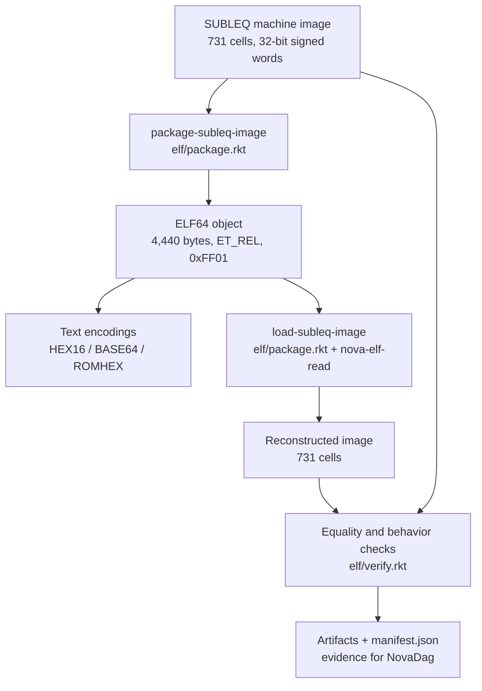

## System architecture

The system has four layers, and the boundaries between them are the point of the design. The machine layer computes. The format layer serializes. The verification layer checks. The provenance layer records. Each layer depends only on the interface of the layer below it, and no layer reaches into the internals of another.


### Module dependencies

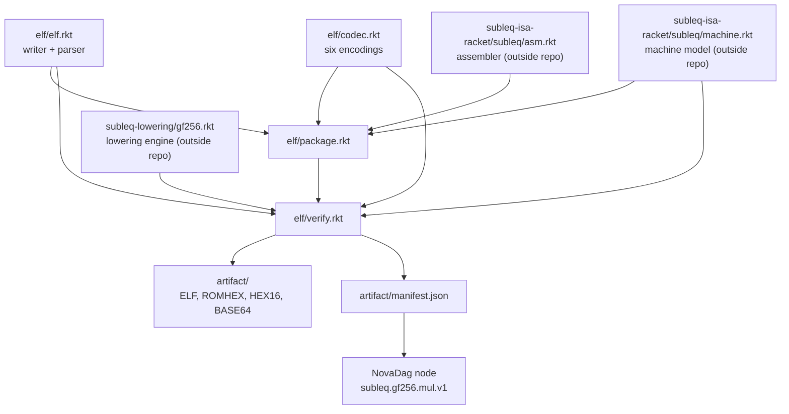

`elf/elf.rkt` depends on nothing in the project: it is a self-contained ELF64 writer and parser with only Racket base libraries. `elf/codec.rkt` depends on `net/base64` for the BASE64 pair and on nothing else. `elf/package.rkt` depends on both, plus the machine and assembler from outside the repository. `elf/verify.rkt` depends on all three modules plus the lowering engine and the machine. The dependency direction is strict: the format modules never import the verifier, and the verifier never defines format behavior. That is what makes the verification meaningful — the checks exercise the same code the user calls, not a parallel implementation.

### What lives where

| Layer | Location | Responsibility |
|---|---|---|
| Machine model | `subleq-isa-racket/subleq/machine.rkt` (outside repo) | The SUBLEQ transition function, memory, halt and error conditions |
| Assembler | `subleq-isa-racket/subleq/asm.rkt` (outside repo) | Items and labels to flat cell images |
| Lowering engine | `subleq-lowering/gf256.rkt` (outside repo) | Cryptol GF(2^8) spec to 731-cell SUBLEQ image, plus the reference `gf-mul-ref` |
| Format writer/parser | `elf/elf.rkt` | ELF64 header, sections, serialization, parsing, validation |
| Encodings | `elf/codec.rkt` | Six reversible base encodings |
| Packaging | `elf/package.rkt` | Image to ELF object, ELF object to image |
| Verification | `elf/verify.rkt` | The executable contract: bijectivity, round trips, exhaustive semantics |
| Artifacts | `artifact/` | The shipped v1 object, encodings, and manifest |
| Provenance | NovaDag (separate repo) | Node records, digests, evidence ingestion |

The format tooling is deliberately separate from the DAG. The DAG records artifacts, hashes, and proof evidence; it does not contain the format tooling. That separation is an architectural decision, not an accident of history: the lowering compiler, the format, and the provenance store change at different rates and for different reasons, and each must be usable without the others. The `.nova.dag` section is the seam — it carries the lineage metadata inside the object, so the object is self-describing even when the DAG is not available.

## The SUBLEQ machine model

This chapter documents the machine the format carries. The machine is defined in `subleq-isa-racket/subleq/machine.rkt`, outside this repository; the semantics below are transcribed from that file and verified by executing it. Nothing in this chapter is inferred from the name SUBLEQ or from textbook descriptions of one-instruction computers. Where the implementation differs from the conventional textbook presentation, the implementation is what is documented.

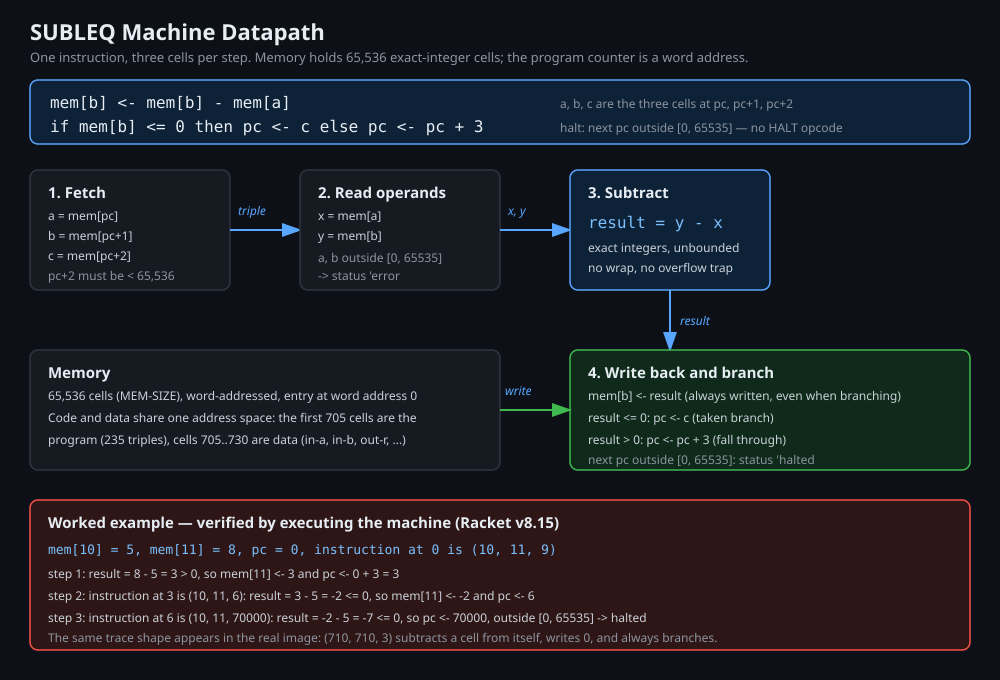

### Machine state

A machine is a record of three fields:

- **`mem`**: a vector of exactly 65,536 cells (`MEM-SIZE`). Each cell holds an exact integer. In the Racket reference implementation the integers are unbounded; the 32-bit signed word is the serialization width, not a limit on the reference machine's arithmetic. A value that falls outside the 32-bit signed range can exist in the running machine but cannot be serialized faithfully — see [Memory representation](#memory-representation).
- **`pc`**: the program counter, a word address into `mem`. Execution starts at word address 0.
- **`status`**: one of `running`, `halted`, `error`, or `fuel`.

`make-machine` creates a machine with all 65,536 cells zeroed, `pc` 0, and status `running`. `machine-load!` copies a flat image into memory starting at cell 0, resets `pc` to 0, and resets the status to `running`. Cells beyond the end of the image keep their previous values — in a fresh machine, zero.

### The instruction

There is one instruction, and it occupies three consecutive cells. At any step, with `pc` the current program counter:

- `a = mem[pc]` — the address of the subtrahend.
- `b = mem[pc + 1]` — the address of the minuend and the destination.
- `c = mem[pc + 2]` — the branch target, a word address.

The triple `(a, b, c)` is the whole instruction set. There are no opcodes, no registers, and no addressing modes. The values `a`, `b`, and `c` are themselves memory cells, so a program can compute its own branch targets and modify its own instructions; the v1 image does both, in the sense that its control flow is data-dependent and its jumps are computed values, not literals in every case.

### The step

`machine-step!` performs one transition. In order:

1. If the status is not `running`, the step does nothing.
2. If `pc` is negative or `pc + 2` exceeds 65,535, the status becomes `error`. The machine cannot fetch a complete triple, so it stops with an error rather than reading out of bounds.
3. Otherwise it reads `a`, `b`, and `c` from `mem[pc]`, `mem[pc + 1]`, and `mem[pc + 2]`.
4. If `a` or `b` is not an integer in `[0, 65535]`, the status becomes `error`. Note that `c` is not range-checked at fetch time: an out-of-range `c` is only discovered when it becomes the next program counter.
5. Otherwise it computes `result = mem[b] - mem[a]`, writes `result` into `mem[b]`, and sets the next program counter: `c` if `result <= 0`, `pc + 3` if `result > 0`.
6. If the next program counter is not in `[0, 65535]`, the status becomes `halted`.

The write to `mem[b]` happens unconditionally — even on a taken branch, and even when `a` equals `b`, in which case the cell is zeroed. This is the property that makes the unconditional jump idiom work: `(x, x, c)` writes `mem[x] - mem[x] = 0` into `mem[x]` and always branches to `c`, because 0 is less than or equal to 0. The first instruction of the v1 image is exactly this idiom, `(710, 710, 3)`.

### Running to completion

`machine-run` steps the machine until the status leaves `running` or a fuel limit is reached. The default fuel is 1,000,000 steps; exhausting it sets the status to `fuel` and returns `fuel`. The other terminal statuses are `halted` (the next program counter left the address range) and `error` (an invalid fetch or an out-of-range operand address). The verification contract requires the status `halted` for every input pair — a run that ends in `error` or `fuel` is a failure, not a result.

### What the machine does not have

- **No HALT instruction.** Halting is a property of the program counter, not an opcode. A program halts by branching or falling through to a program counter outside `[0, 65535]`. The word `0xF0000000` labeled HALT in the `.nova.urom` descriptor is a dispatch word for the outer ROM controller, not a SUBLEQ instruction; it never appears in the machine's memory.
- **No input/output.** The machine has no I/O instructions, ports, or system calls. Inputs are written into memory cells before the run (the verifier writes `a` and `b` into `in-a` and `in-b`), and the output is read from a memory cell after the run (`out-r`). A program that needs to interact with the outside world must do so through memory.
- **No interrupts, no privilege levels, no separate code and data.** Code and data share one address space, and any cell can be executed as an instruction or read as data. The section split in the ELF object (`.nova.text` versus `.nova.data`) is a packaging distinction, not a hardware protection boundary.
- **No overflow trap.** The reference machine computes with exact integers, so subtraction never wraps and never traps. The 32-bit serialization bound is a property of the file format, and a value outside that range is a serialization failure, not a machine error.

## Formal machine semantics

Let the machine state be `(mem, pc, status)` with `mem` a vector of 65,536 exact integers, `pc` an integer, and `status` in `{running, halted, error, fuel}`. Let `N = 65536`.

**Fetch.** If `status != running`, the state is unchanged. Else if `pc < 0` or `pc + 2 > N - 1`, the next state is `(mem, pc, error)`. Else let `a = mem[pc]`, `b = mem[pc+1]`, `c = mem[pc+2]`.

**Operand validation.** If `a` is not an integer in `[0, N-1]` or `b` is not an integer in `[0, N-1]`, the next state is `(mem, pc, error)`.

**Execute.** Let `result = mem[b] - mem[a]` and `mem'` be `mem` with cell `b` set to `result`. Let `pc' = c` if `result <= 0`, else `pc + 3`.

**Halt check.** If `pc'` is not in `[0, N-1]`, the next state is `(mem', pc', halted)`. Otherwise the next state is `(mem', pc', running)`.

**Run.** `machine-run` applies the step function repeatedly until `status != running` or 1,000,000 steps have been taken, in which case the status becomes `fuel`.

Three consequences follow from this definition and are worth stating plainly, because they shape everything the format does:

1. **The branch condition is `<= 0`, not `< 0`.** A result of exactly zero branches. This is what makes the `(x, x, c)` idiom an unconditional jump: the result is always exactly zero.
2. **The destination is written before the branch is decided.** There is no way to test a value without destroying it, which is why SUBLEQ programs keep scratch cells and restore values they still need. The v1 image's data cells include exactly such scratch space.
3. **Halting is emergent.** Nothing in the machine says "stop"; the program stops by arranging for the program counter to leave the memory. A program that never does that runs until it exhausts its fuel.

### Instruction semantics table

| Aspect | Definition |
|---|---|
| Instruction width | 3 cells: `(a, b, c)` |
| Operand `a` | Word address of the subtrahend; must be in `[0, 65535]` |
| Operand `b` | Word address of the minuend and destination; must be in `[0, 65535]` |
| Operand `c` | Branch target, a word address; checked only when it becomes the next `pc` |
| Operation | `mem[b] <- mem[b] - mem[a]` |
| Branch taken | `result <= 0`, then `pc <- c` |
| Fall through | `result > 0`, then `pc <- pc + 3` |
| Write | Always performed, including on a taken branch and when `a = b` |
| Halt | Next `pc` outside `[0, 65535]` |
| Error | `pc` cannot fetch a full triple, or `a`/`b` out of range |
| Fuel | 1,000,000 steps by default, then status `fuel` |
| Arithmetic | Exact integers in the reference machine; no wrap, no trap |
| I/O | None; inputs and outputs are memory cells |

## Worked examples

All three examples in this section were executed against the reference machine (`machine.rkt`, Racket v8.15) and the arithmetic was checked against the trace output. The first is a hand-built program that exercises the branch in both directions and the halt condition. The second is the opening of the real v1 image. The third is a full run of the real image computing a GF(2^8) product.

### Example 1 — a three-step program

Memory before the run:

| Address | 0 | 1 | 2 | 3 | 4 | 5 | 6 | 7 | 8 | 9 | 10 | 11 |
|---|---|---|---|---|---|---|---|---|---|---|---|---|
| Value | 10 | 11 | 9 | 10 | 11 | 6 | 10 | 11 | 70000 | 0 | 5 | 8 |

The program is three instructions: `(10, 11, 9)` at address 0, `(10, 11, 6)` at address 3, and `(10, 11, 70000)` at address 6. Cells 10 and 11 hold the operands, 5 and 8.

| Step | PC | Instruction | Memory before | Memory after | Next PC |
|---|---|---|---|---|---|
| 1 | 0 | (10, 11, 9) | mem[11] = 8 | mem[11] = 8 - 5 = 3 | 3 (3 > 0, fall through) |
| 2 | 3 | (10, 11, 6) | mem[11] = 3 | mem[11] = 3 - 5 = -2 | 6 (-2 <= 0, branch) |
| 3 | 6 | (10, 11, 70000) | mem[11] = -2 | mem[11] = -2 - 5 = -7 | 70000 (-7 <= 0, branch out of range: halted) |

Three properties of the semantics are visible here. First, the fall-through case: step 1 produces 3, which is greater than zero, so the machine advances to `pc + 3` and ignores the branch target 9. Second, the branch case: step 2 produces -2, which is less than or equal to zero, so the machine jumps to 6. Third, the halt: step 3 branches to 70000, which is outside `[0, 65535]`, so the machine stops with status `halted` — and note that `mem[11]` was still written (-7) before the halt was decided, because the write is unconditional.

### Example 2 — the opening of the v1 image

The first twelve cells of the shipped 731-cell image are:

```
710 710 3 709 709 6 729 729 9 706 729 12
```

Read as triples, the first four instructions are:

| Address | Triple | Reading |
|---|---|---|
| 0 | (710, 710, 3) | `mem[710] - mem[710] = 0`, always branch to 3. Unconditional jump. |
| 3 | (709, 709, 6) | `mem[709] - mem[709] = 0`, always branch to 6. Unconditional jump. |
| 6 | (729, 729, 9) | `mem[729] - mem[729] = 0`, always branch to 9. Unconditional jump. |
| 9 | (706, 729, 12) | `mem[729] <- mem[729] - mem[706]`; branch to 12 if the result is `<= 0`, else fall through to 12. |

The first three instructions are the jump idiom: subtracting a cell from itself always yields zero, and zero always branches. The fourth instruction is the first real computation — it subtracts the contents of cell 706 (the `in-b` input cell) from cell 729 (a scratch cell) and branches on the result. The two possible next program counters coincide here (both 12), which is a coincidence of this instruction, not a property of the machine.

### Example 3 — a full GF(2^8) multiplication

The image computes GF(2^8) multiplication — the finite-field product used by the AES S-box layer — by the shift-and-add method with reduction modulo the polynomial `x^8 + x^4 + x^3 + x + 1` (hex `0x11B`). The inputs are written into `in-a` (cell 705) and `in-b` (cell 706); the result is read from `out-r` (cell 707) after the machine halts.

For the input pair `(87, 131)` — that is, `(0x57, 0x83)`:

| Quantity | Value |
|---|---|
| Input `a` (cell 705) | 87 |
| Input `b` (cell 706) | 131 |
| Reference product `gf-mul-ref(87, 131)` | 193 (`0xC1`) |
| Run status | `halted` |
| Output `out-r` (cell 707) | 193 |

The machine run halts and the output cell holds 193, matching the reference exactly. The same check is performed for every one of the 65,536 input pairs in the verification contract; the count of mismatches is 0. Other spot values of the reference function, confirmed by executing `gf-mul-ref` directly: `gf-mul-ref(1, 128) = 128`, `gf-mul-ref(2, 3) = 6`, `gf-mul-ref(255, 255) = 19`, `gf-mul-ref(0, 0) = 0`, `gf-mul-ref(1, 1) = 1`, `gf-mul-ref(83, 83) = 181`. The case `(1, 128)` is the discriminating one for the lowering: the product is 128, not 0, because the multiplication processes all eight bits of the second operand including its top bit.

The step count is data-dependent: over the full sweep the run takes between 333 and 7,978 steps depending on the inputs (reported by the lowering baseline; a 16-by-16 sampled grid reproduced the minimum of 333 on this machine). The variation comes from the conditional XOR and the xtime reduction branching on operand bits. The image is therefore functionally correct and not constant-time, and no claim in this manual should be read as a timing claim.

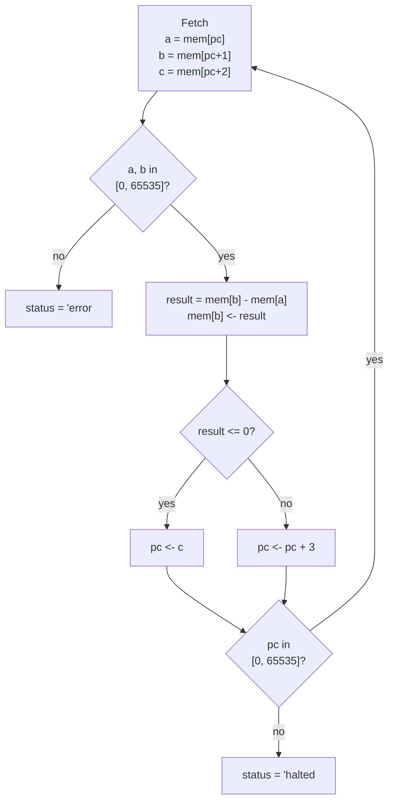

## Memory representation

Five different things are easily confused in this project, and the format's correctness depends on keeping them apart: integer machine values, serialized bytes, word addresses, ELF offsets, and native processor instructions. This chapter separates them.

| Concept | What it is | Width / range | Where it appears |
|---|---|---|---|
| Machine value | An exact integer held in a memory cell | Unbounded in the reference machine; must fit 32-bit signed for serialization | `mem` vector, program behavior |
| Serialized word | A machine value encoded as bytes | 32 bits, signed, little-endian | Section contents, ROMHEX values |
| Word address | An index into the 65,536-cell memory | 0..65,535 | Instruction operands, labels, `pc` |
| ELF offset | A byte position inside the object file | 0..4,439 for the v1 artifact | Section headers, `e_shoff` |
| Native instruction | An instruction for a real CPU | Not applicable | Nowhere — this object never runs natively |

### The 32-bit signed word

A machine value is serialized by `cells->bytes` (`elf/elf.rkt`) as a 32-bit signed little-endian integer, using Racket's `integer->integer-bytes` with 4 bytes, signed, little-endian. The value -1 becomes the bytes `FF FF FF FF`; the value 729 becomes `D9 02 00 00`; the value 0 becomes four zero bytes. Deserialization is the inverse: `integer-bytes->integer` with 4 bytes, signed, little-endian, applied to each consecutive 4-byte group.

The serialization is faithful exactly when every cell in the image fits in the 32-bit signed range `[-2^31, 2^31 - 1]`. The v1 image satisfies this with wide margin: its values span -1 to 729, verified by direct inspection of the assembled image. Sampled execution values reach -256 in the reported baseline (a 16-by-16 sampled grid run for this manual observed -254; the -256 figure is the previously reported sampled measurement). All of these are far inside the 32-bit range. But the bound is a property of the image, not of the machine: the reference machine computes with unbounded exact integers, and a program that produced a value outside the 32-bit range would serialize incorrectly — `integer->integer-bytes` raises an error for an out-of-range value rather than wrapping silently, so the failure is loud, not silent. Changing the arithmetic width changes behavior, and the width is therefore part of the ABI recorded in `.note.nova` (`word=32-bit signed LE`).

### Word addresses versus byte offsets

The machine is word-addressed: address 5 means the fifth word, which is the sixth cell of memory, and the instruction at word address 0 occupies cells 0, 1, and 2. The ELF file is byte-addressed: offset 64 means the 64th byte of the file. Converting between the two requires knowing the word width: word address `w` in a section that starts at byte offset `o` is at file offset `o + 4*w`. The `.nova.text` section starts at file offset 64, so machine word address 0 is at file offset 64, word address 1 at 68, and word address 704 (the last code word) at 2,880. The `.nova.data` section starts at file offset 2,884, so data word 0 (machine address 705, the `in-a` cell) is at file offset 2,884, and data word 2 (machine address 707, the `out-r` cell) is at file offset 2,892. ROMHEX uses word addresses exclusively — each line gives an explicit word address — which is why it is the natural format for ROM initialization, where the hardware indexes by word.

### The image and its identity

The canonical binary image is the 731 cells serialized as 32-bit signed little-endian words: 2,924 bytes. Its SHA-256 digest, `153be573ab87f6a62f9c102cef88ee1a4e0ccfb501115c5e0ed0f8fa454ca673`, is the identity of the microcode. It is distinct from the SHA-256 of the ELF file (`4c2605a5...`), which covers the headers, section metadata, and proof records in addition to the image bytes. The distinction matters: two ELF files could package the same image with different metadata and would have different file digests but the same image digest. The image digest is what the DAG records, what `.nova.urom` carries, and what the proof section asserts. Encodings do not affect it: the HEX16, BASE64, and ROMHEX artifacts are different representations of the same image, and their digests differ from each other and from the image digest, because a digest is over bytes, not over meaning.

## The ELF64 container

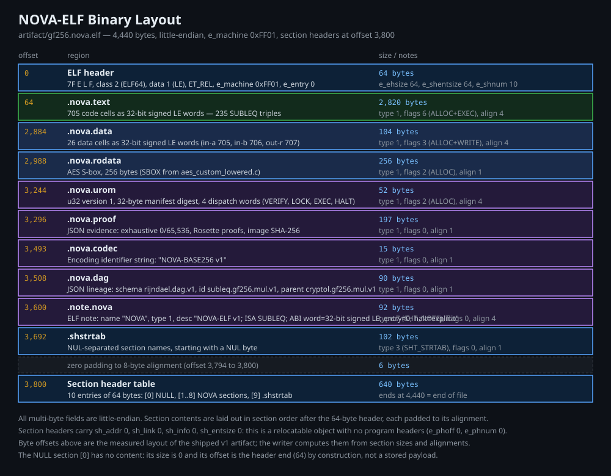

A NOVA-ELF file is a well-formed ELF64 relocatable object. This chapter documents the header field by field, using the values the writer produces and the values measured from the shipped artifact. The writer is `nova-elf-write` (`elf/elf.rkt`); the reader is `nova-elf-read` in the same file.

### ELF header

The header is 64 bytes (`e_ehsize = 64`). All multi-byte fields are little-endian (`EI_DATA = 1`).

| Offset | Field | Size | Value (v1 artifact) | Meaning |
|---|---|---|---|---|
| 0 | `e_ident[EI_MAG0..3]` | 4 | `7F 45 4C 46` | Magic: `\177ELF` |
| 4 | `e_ident[EI_CLASS]` | 1 | 2 | ELFCLASS64 |
| 5 | `e_ident[EI_DATA]` | 1 | 1 | ELFDATA2LSB, little-endian |
| 6 | `e_ident[EI_VERSION]` | 1 | 1 | EV_CURRENT |
| 7 | `e_ident[EI_OSABI]` | 1 | 0 | ELFOSABI_NONE (System V) |
| 8 | `e_ident[EI_ABIVERSION]` | 1 | 0 | ABI version 0 |
| 9 | `e_ident[EI_PAD]` | 7 | all zero | Padding |
| 16 | `e_type` | 2 | 1 | `ET_REL`, relocatable object |
| 18 | `e_machine` | 2 | `0xFF01` | `EM_NOVA_SUBLEQ`, unregistered, v1 only |
| 20 | `e_version` | 4 | 1 | `EV_CURRENT` |
| 24 | `e_entry` | 8 | 0 | Entry, word address 0 |
| 32 | `e_phoff` | 8 | 0 | No program header table |
| 40 | `e_shoff` | 8 | 3,800 | Offset of the section header table |
| 48 | `e_flags` | 4 | 0 | No processor flags |
| 52 | `e_ehsize` | 2 | 64 | ELF header size |
| 54 | `e_phentsize` | 2 | 0 | No program headers |
| 56 | `e_phnum` | 2 | 0 | No program headers |
| 58 | `e_shentsize` | 2 | 64 | Section header entry size |
| 60 | `e_shnum` | 2 | 10 | Number of section headers |
| 62 | `e_shstrndx` | 2 | 9 | Index of `.shstrtab` |

### The machine identifier

`e_machine = 0xFF01` (`EM-NOVA-SUBLEQ` in the source) is the format's most consequential single field. The value lies in the processor-specific reserved range of the ELF machine field (`0xFF00`–`0xFFFF` are reserved for processor-specific use). It is unregistered: no standards body has assigned it, no generic tool knows what it means, and it must not be treated as a registered machine type. Its purpose is negative: it guarantees that no generic toolchain will mistake this object for code for a real processor, and it gives the dedicated loader a single field to check before interpreting anything else. The reader enforces it — `nova-elf-read` raises `"not a NOVA-ELF (e_machine=...)"` for any other value — and the check happens before any section header is read. The identifier is versioned by convention, not by the field itself: v1 uses `0xFF01`, and any future version would need its own identifier or its own version record in `.note.nova`. The consequences for portability are deliberate: a NOVA-ELF file is portable as a byte stream, but it is not interoperable with generic ELF tools beyond header parsing and section dumping. `readelf -h` will display the header and report an unknown machine; `readelf -S` will list the sections; nothing in a standard toolchain will execute or link the object, which is exactly the intent.

### Container versus machine

| Property | ELF container | SUBLEQ machine |
|---|---|---|
| Representation width | 64-bit ELF format | 32-bit signed words |
| Addressing | Byte-oriented ELF offsets | Word-addressed memory |
| Instruction representation | Custom section payload (`.nova.text`) | `(a, b, c)` triples in memory |
| Loading | Dedicated NOVA parser (`nova-elf-read`) | Defined machine state (`make-machine`, `machine-load!`) |
| Native Linux execution | Not applicable — `ET_REL`, no program headers, `e_entry` 0 | Virtual machine semantics only |
| Entry | `e_entry` 0 (a word address, not a byte address) | Word address 0 |
| Endianness | Little-endian (`EI_DATA` 1) | Little-endian serialization of 32-bit words |

The `e_entry` field deserves a note, because it sits at the seam between the two widths. In a standard ELF file `e_entry` is a virtual byte address. In NOVA-ELF it is 0, and the format treats it as the machine's entry word address — which is also 0. The value is consistent under either reading only because it is zero. A nonzero entry would be ambiguous, and the format avoids the question by defining entry as word address 0 in the ABI note and writing 0 in the header. The `.note.nova` description string records `entry=0` explicitly for this reason.

### Section headers

The section header table follows the section contents, 8-byte aligned, at the offset recorded in `e_shoff` (3,800 in the v1 artifact). Each entry is 64 bytes (`e_shentsize = 64`), in the standard ELF64 layout:

| Offset in entry | Field | Size | Value in this format |
|---|---|---|---|
| 0 | `sh_name` | 4 | Offset into `.shstrtab` (0 for the NULL section) |
| 4 | `sh_type` | 4 | See the section table below |
| 8 | `sh_flags` | 8 | See the section table below |
| 16 | `sh_addr` | 8 | 0 for every section |
| 24 | `sh_offset` | 8 | Byte offset of the section contents |
| 32 | `sh_size` | 8 | Size of the section contents in bytes |
| 40 | `sh_link` | 4 | 0 for every section |
| 44 | `sh_info` | 4 | 0 for every section |
| 48 | `sh_addralign` | 8 | The section alignment, minimum 1 |
| 56 | `sh_entsize` | 8 | 0 for every section |

Four fields are always zero in this format and their zero values are part of the contract: `sh_addr` is 0 because the sections are not loaded at a virtual address; `sh_link` and `sh_info` are 0 because no section references another by index; `sh_entsize` is 0 because no section has fixed-size entries. A reader that encounters nonzero values in these fields is looking at a file this writer did not produce, and should treat it with suspicion rather than assume the values mean what they would mean in a generic ELF file.

The table has 10 entries: index 0 is the NULL section (all fields zero except `sh_offset`, which the writer sets to 64, the end of the header, with size 0 — a consequence of the layout loop, not a stored payload), indices 1 through 8 are the eight NOVA sections in the fixed order `.nova.text`, `.nova.data`, `.nova.rodata`, `.nova.urom`, `.nova.proof`, `.nova.codec`, `.nova.dag`, `.note.nova`, and index 9 is `.shstrtab`. The order is fixed by the writer's `SECTION-NAMES` list and by the order in which `package-subleq-image` supplies the sections; the reader does not depend on the order, because it resolves sections by name through `.shstrtab`, but a producer that reordered them would still produce a valid file that this reader accepts.

### The shipped layout

The table below is the measured layout of `artifact/gf256.nova.elf`, read from the file itself. It is the ground truth for the v1 artifact; the writer computes these offsets from section sizes and alignments, so a different image would produce different offsets.

| Index | Section | File offset | Size (bytes) | Alignment |
|---|---|---|---|---|
| 0 | (NULL) | 64 | 0 | 1 |
| 1 | `.nova.text` | 64 | 2,820 | 4 |
| 2 | `.nova.data` | 2,884 | 104 | 4 |
| 3 | `.nova.rodata` | 2,988 | 256 | 1 |
| 4 | `.nova.urom` | 3,244 | 52 | 4 |
| 5 | `.nova.proof` | 3,296 | 197 | 1 |
| 6 | `.nova.codec` | 3,493 | 15 | 1 |
| 7 | `.nova.dag` | 3,508 | 90 | 1 |
| 8 | `.note.nova` | 3,600 | 92 | 4 |
| 9 | `.shstrtab` | 3,692 | 102 | 1 |
| — | (padding) | 3,794 | 6 | — |
| — | Section header table | 3,800 | 640 | 8 |

The arithmetic checks out: 3,800 + 640 = 4,440, the file size. The section contents are laid out in section order starting immediately after the 64-byte header, each padded forward to its alignment. The only nonzero padding inside the content region is the 2-byte pad before `.note.nova` (3,598 to 3,600, because `.note.nova` requires 4-byte alignment and the preceding section ends at 3,598) and the 6-byte pad before the section header table (3,794 to 3,800, for 8-byte alignment). All padding bytes are zero.

## Custom section reference

There are eight NOVA sections plus the standard `.shstrtab`. The table below is the complete reference; the subsections that follow give the byte-level detail for each one.

| Section | Type | Flags | Align | Size (v1) | Purpose |
|---|---|---|---|---|---|
| `.nova.text` | 1 (PROGBITS) | 6 (ALLOC+EXEC) | 4 | 2,820 | SUBLEQ instruction triples (code) |
| `.nova.data` | 1 (PROGBITS) | 3 (ALLOC+WRITE) | 4 | 104 | Initial machine memory (data) |
| `.nova.rodata` | 1 (PROGBITS) | 2 (ALLOC) | 1 | 256 | Constants: the AES S-box |
| `.nova.urom` | 1 (PROGBITS) | 2 (ALLOC) | 4 | 52 | Microprogram descriptor: version, digest, dispatch words |
| `.nova.proof` | 1 (PROGBITS) | 0 | 1 | 197 | Proof evidence as JSON |
| `.nova.codec` | 1 (PROGBITS) | 0 | 1 | 15 | Encoding identifier string |
| `.nova.dag` | 1 (PROGBITS) | 0 | 1 | 90 | Transformation lineage as JSON |
| `.note.nova` | 7 (NOTE) | 0 | 4 | 92 | Format, ISA, and ABI version note |
| `.shstrtab` | 3 (STRTAB) | 0 | 1 | 102 | Section name string table |

Section types use the standard ELF numbers: 1 is `SHT_PROGBITS`, 3 is `SHT_STRTAB`, 7 is `SHT_NOTE`. Flags use the standard bits: 2 is `SHF_ALLOC`, 1 is `SHF_WRITE`, 4 is `SHF_EXECINSTR`, so `.nova.text` at 6 is ALLOC+EXEC and `.nova.data` at 3 is ALLOC+WRITE. These flags describe the section's role in the object, not hardware enforcement: nothing in the loader checks them, and the machine does not distinguish executable from writable memory. They are set to the values a reader familiar with ELF would expect for code, data, and read-only data, so that generic tools classify the sections sensibly.

### .nova.text — instruction triples

- **Purpose.** The code half of the machine image: the SUBLEQ program itself.
- **Mandatory.** Yes, for any image that is meant to run. The loader (`load-subleq-image`) requires it by name and raises an error if it is absent.
- **Content.** The 705 code cells serialized as 32-bit signed little-endian words, in address order. Cell 0 of the section is machine word address 0; cell `i` of the section is machine word address `i`.
- **Width and endianness.** 4 bytes per cell, signed, little-endian.
- **Alignment.** 4.
- **Serializer.** `cells->bytes` (`elf/elf.rkt`), applied to the code cells by `package-subleq-image` (`elf/package.rkt`).
- **Parser.** `load-subleq-image` reads the section bytes and converts each 4-byte group with `integer-bytes->integer` (4 bytes, signed, little-endian).
- **Validation.** None beyond the ELF-level checks. The loader does not verify that the section size is a multiple of 4, that the cell count is a multiple of 3, or that the triples are valid instructions. A truncated section would produce a short image; a section whose size is not a multiple of 4 would cause the byte-to-cell conversion to fail on the final partial group (Racket's `subbytes` raises on an out-of-range slice).
- **Example.** The section opens with the bytes `C6 02 00 00 C6 02 00 00 03 00 00 00`, which decode as the words 710, 710, 3 — the first instruction, `(710, 710, 3)`, the unconditional jump idiom.

### .nova.data — initial machine memory

- **Purpose.** The data half of the machine image: the initial values of the 26 data cells.
- **Mandatory.** Yes, for any image that has data. The loader requires it by name.
- **Content.** The 26 data cells serialized as 32-bit signed little-endian words, in address order. Cell 0 of the section is machine word address 705 (the first address after the code); cell `i` of the section is machine word address `705 + i`.
- **Width and endianness.** 4 bytes per cell, signed, little-endian.
- **Alignment.** 4.
- **Serializer / parser.** Same functions as `.nova.text`.
- **Validation.** None beyond the ELF-level checks. The split between code and data is positional — the first 705 cells are code, the rest are data — and the section boundary is where that decision is recorded. If a producer split the image at a different cell, the loader would still concatenate the two sections in order and return whatever image the sections describe; the 705/26 split is a property of this image, enforced by the `CODE-CELLS` constant in `package.rkt`, not by the file format.
- **Example.** The data cells at addresses 705, 706, and 707 are `in-a`, `in-b`, and `out-r`. They are all zero in the initial image; the verifier writes the inputs into `in-a` and `in-b` before each run and reads the result from `out-r` after it halts. The last six data cells of the image are 128, 256, 0, 1, 0, 0 — constants the program uses.

### .nova.rodata — constants

- **Purpose.** Read-only constants the program needs: in v1, the AES S-box.
- **Mandatory.** No. The loader never reads this section. Its presence documents the constants the image was built against.
- **Content.** The 256-byte AES S-box (`SBOX` in `elf/elf.rkt`), in standard order: byte 0 is `0x63`, byte 1 is `0x7c`, byte 255 is `0x16`. The table is copied from `aes_custom_lowered.c`, the C reference for the custom AES layer, and is the standard AES S-box.
- **Width and endianness.** Single bytes; endianness does not apply.
- **Alignment.** 1.
- **Serializer / parser.** The bytes are placed directly; no function reads them back in this repository.
- **Validation.** None. The section is payload, not contract.
- **Relationship.** The S-box is a lookup table for the AES layer of the wider DAG stack. Its presence here does not mean this repository implements an AES cipher — it does not. It means the packaged image's lineage runs through the custom AES work, and the table the program was built against is preserved with the program. A reader that wants to check the S-box can compare it against the standard table; the first row is `63 7c 77 7b f2 6b 6f c5 30 01 67 2b fe d7 ab 76`.

### .nova.urom — microprogram descriptor

- **Purpose.** The descriptor for the outer ROM controller: the version of the descriptor format, the digest of the manifest the controller must verify, and the dispatch words the controller executes.
- **Mandatory.** No, for loading the image — the loader never reads this section. It is mandatory for the outer ROM controller that consumes the artifact downstream.
- **Content.** 52 bytes, laid out as: a 4-byte unsigned little-endian version (`1`), a 32-byte manifest digest, and four 4-byte unsigned little-endian dispatch words. The full chapter is [Microprogram metadata: .nova.urom](#microprogram-metadata-novaurom).
- **Width and endianness.** 4-byte unsigned little-endian words.
- **Alignment.** 4.
- **Serializer.** Built inline in `package-subleq-image` with a local `u32` helper.
- **Parser.** None in this repository. The controller that consumes it is the VHDL `nested_rom_controller` in the NovaDag tree.
- **Validation.** None in this repository.

### .nova.proof — proof evidence

- **Purpose.** Evidence about the image, as a JSON string: what was checked, what the results were, and the digest that identifies the image.
- **Mandatory.** No. The loader never reads it.
- **Content.** In the v1 artifact, the 197-byte JSON string:

```json
{"exhaustive":"0 mismatches / 65536 pairs","rosette":"zeroIdentity PROVED, oneIdentity PROVED, commutative PROVED","image_sha256":"153be573ab87f6a62f9c102cef88ee1a4e0ccfb501115c5e0ed0f8fa454ca673"}
```

- **Width and endianness.** UTF-8 text; no numeric fields inside the section.
- **Alignment.** 1.
- **Serializer / parser.** The string is supplied by the caller (`proof-json` in `verify.rkt`) and placed as bytes; no function in this repository parses it back.
- **Validation.** None. The section is a claim record, not a checked proof. The words "PROVED" in it refer to the Rosette/Z3 checks run by the lowering engine, which is a separate system with its own evidence; this repository records the results, it does not reproduce them. A reader must not mistake the presence of this section for a formal verification of the ELF object — the formal status of the loader and codec is a registered, undischarged obligation, stated plainly in [Verification contracts](#verification-contracts).

### .nova.codec — encoding identifier

- **Purpose.** Records which encoding produced the artifact.
- **Mandatory.** No. The loader never reads it.
- **Content.** The 15-byte UTF-8 string `NOVA-BASE256 v1`.
- **Width and endianness.** UTF-8 text.
- **Alignment.** 1.
- **Serializer / parser.** The string is a literal in `package-subleq-image`; no function reads it back.
- **Validation.** None.
- **Meaning.** The identifier says the canonical binary form of the image is the BASE256 identity — the image bytes themselves, unencoded. It is a statement about the canonical form, not about the file that carries it: the ELF file in `artifact/` is also distributed as HEX16 and BASE64, and those encodings are recorded in the manifest, not in this section. A future artifact encoded differently would carry a different identifier here.

### .nova.dag — transformation lineage

- **Purpose.** Records the artifact's identity and its parent in the transformation lineage, as a JSON string, so the object is self-describing even when the DAG is not available.
- **Mandatory.** No. The loader never reads it.
- **Content.** In the v1 artifact, the 90-byte JSON string:

```json
{"schema":"rijndael.dag.v1","id":"subleq.gf256.mul.v1","parents":["cryptol.gf256.mul.v1"]}
```

- **Width and endianness.** UTF-8 text.
- **Alignment.** 1.
- **Serializer / parser.** The string is supplied by the caller (`dag-json` in `verify.rkt`); no function in this repository parses it back.
- **Validation.** None.
- **Meaning.** The schema is `rijndael.dag.v1`, the node id is `subleq.gf256.mul.v1`, and the single parent is `cryptol.gf256.mul.v1` — the Cryptol specification the image was lowered from. The section records lineage; it does not create a DAG record. Creating and storing the node is NovaDag's job, and the DAG ingests the manifest, not this section directly. See [Relationship to NovaDag](#relationship-to-novodag).

### .note.nova — version note

- **Purpose.** The standard ELF note carrying the format, ISA, and ABI version information.
- **Mandatory.** No, for loading — the loader never reads it. It is the authoritative version record for any reader that needs one.
- **Content.** One note, laid out as: `namesz` (u32, 4), `descsz` (u32, 74), `type` (u32, 1), the name `NOVA` (4 bytes, already 4-aligned, no padding needed), and the description (74 bytes, padded to 76 with two zero bytes). Total section size: 12 + 4 + 76 = 92 bytes. The description is the UTF-8 string:

```
NOVA-ELF v1; ISA SUBLEQ; ABI word=32-bit signed LE; entry=0; halt=explicit
```

- **Width and endianness.** 4-byte unsigned little-endian header fields; the name and description are bytes.
- **Alignment.** 4. The name and description are each padded to a multiple of 4 with zero bytes, per the ELF note convention.
- **Serializer.** `note-nova-bytes` (`elf/elf.rkt`), which builds the note from the name and description strings with a `pad4` helper.
- **Parser.** None in this repository. A generic ELF note reader can parse it.
- **Validation.** None in this repository.
- **Reading the description.** Each clause is a contract term. `NOVA-ELF v1` is the format and version. `ISA SUBLEQ` is the target instruction set. `ABI word=32-bit signed LE` is the machine word width, signedness, and byte order. `entry=0` is the entry word address. `halt=explicit` records that halting is an explicit property of the machine's program-counter behavior — the program halts by driving the counter out of range — rather than an implicit halt at the end of a code section or a HALT instruction. The note type is 1, which this format defines as the version note; no other note types are defined in v1.

## Object construction

`nova-elf-write` takes a list of section descriptions and returns the complete ELF file as bytes. A section description is a list of five elements: `(name type flags align content-bytes)`. The caller supplies the eight NOVA sections in order; the writer adds the NULL section at the front and `.shstrtab` at the end. The caller never supplies the NULL section or the string table, and the writer never inspects the content of a section — it treats every section as opaque bytes with a name, a type, flags, and an alignment.

The construction proceeds in five steps:

1. **Build `.shstrtab`.** The writer concatenates the section names as NUL-terminated strings, starting with a single NUL byte: `\0` + `.nova.text\0` + `.nova.data\0` + ... + `.shstrtab\0`. For the v1 section list this produces 102 bytes. It also records the byte offset of each name in a hash, so the section headers can point at the right names.
2. **Lay out the contents.** Starting at offset 64 (immediately after the ELF header), each section in order is padded forward to its alignment and placed. The writer tracks the running offset and records each section's final offset and size. The NULL section has empty content and zero size; its recorded offset is 64, the position where the layout started.
3. **Place the section header table.** The table offset is the end of the contents, padded forward to 8-byte alignment. For the v1 artifact that is 3,800.
4. **Build the ELF header.** The header is assembled from the computed values: `e_shoff` from step 3, `e_shnum` as the total section count (10), `e_shstrndx` as the index of `.shstrtab` (9), and the fixed values from the header table above.
5. **Assemble the file.** The header, the section contents with their padding, the padding before the header table, and the section headers are concatenated. Each section header is built from the laid-out record: the name offset from step 1, the type, the flags, a zero address, the offset, the size, zero link and info, the alignment (minimum 1), and a zero entry size.

The writer makes no decisions about the content. It does not check that `.nova.text` holds valid triples, that the section count is what the reader expects, or that the names match `SECTION-NAMES`. The `SECTION-NAMES` constant in `elf.rkt` lists the nine names (the eight NOVA sections plus `.shstrtab`) in order, and is used only to build the string table and the name offsets. A caller could pass a different section list and get a well-formed ELF file with different sections; the reader would then accept it if the machine identifier matched and `.nova.text` and `.nova.data` were present, because the reader resolves sections by name. The writer's job is framing, not policy, and the policy lives in `package-subleq-image`, which is the only caller in this repository.

## Loader and parser

`nova-elf-read` takes ELF bytes and returns a hash with five keys: `type`, `machine`, `entry`, `shnum`, and `sections`, where `sections` is itself a hash from section name to content bytes. `nova-elf-sections` is a one-line accessor that returns the `sections` hash. `load-subleq-image` builds on the reader: it extracts `.nova.text` and `.nova.data`, converts each from bytes to 32-bit signed words, and concatenates them into the flat image.

### What the reader checks

The reader validates, in order:

1. **Length.** The input must be at least 64 bytes, or it raises `"not an ELF file"`. A shorter input is not an ELF file, and the reader refuses to index into it.
2. **Magic.** Bytes 0 through 3 must be `7F 45 4C 46`. Anything else raises `"not an ELF file"`.
3. **Class.** Byte 4 must be 2 (ELFCLASS64), or it raises `"not ELF64"`.
4. **Data encoding.** Byte 5 must be 1 (little-endian), or it raises `"not little-endian"`.
5. **Machine.** The `e_machine` field at offset 18 must equal `0xFF01`, or it raises `"not a NOVA-ELF (e_machine=...)"` with the actual value.

Only after those five checks does the reader touch the section headers. It reads `e_shoff` (offset 40), `e_shentsize` (offset 58), `e_shnum` (offset 60), and `e_shstrndx` (offset 62), then reads each section header: name offset, type, flags, file offset, and size. It reads the `.shstrtab` contents using the header at `e_shstrndx`, resolves each section's name by scanning for the terminating NUL byte, and slices each section's bytes out of the file with `subbytes`.

### What the reader does not check

The omissions are as important as the checks, because they define the trust boundary:

- **It does not check `e_type`.** A file with `e_type` 2 (`ET_EXEC`) or 3 (`ET_DYN`) and `e_machine` `0xFF01` would be accepted. The writer always produces 1 (`ET_REL`), but the reader does not enforce it.
- **It does not check `e_version`, `e_entry`, `e_flags`, or the header sizes.** Any values in those fields are accepted and mostly ignored; `e_entry` is returned in the hash but never used by the loader.
- **It does not validate section header bounds.** If `e_shoff` points past the end of the file, or `e_shnum` claims more entries than fit, or a section's offset and size run past the end of the file, the reader does not detect it in advance. Racket's `subbytes` raises an error when asked for an out-of-range slice, so the failure is loud — an exception, not silent corruption — but it is a bounds error from the runtime, not a validation error from the reader.
- **It does not validate `e_shstrndx`.** An out-of-range string table index would cause `list-ref` to fail, again loudly.
- **It does not check section names against `SECTION-NAMES`.** Any section name found in the string table is accepted and placed in the hash. Duplicate names are silently overwritten — the later section wins — because the sections hash is keyed by name.
- **It does not check that section sizes are sensible.** A `.nova.text` whose size is not a multiple of 4 is accepted by the reader; the failure happens later, in `load-subleq-image`, when the byte-to-cell conversion tries to slice the final partial group.

The practical consequence is that the reader is safe to run on untrusted input in the narrow sense that it will not silently produce a wrong image — it either returns the sections as recorded in the file or raises an error. It is not safe in the sense of a hardened parser: it assumes the header fields it uses are at least self-consistent enough for the runtime's bounds checks to catch the inconsistencies. The input assumptions are stated precisely in [Security considerations](#security-considerations).

### Reconstruction

`load-subleq-image` performs the reconstruction in three steps:

1. Parse the ELF bytes with `nova-elf-read`.
2. Look up `.nova.text` and `.nova.data` in the sections hash. A missing section raises a Racket hash error (`hash-ref: no value found for key`).
3. Convert each section's bytes to cells — 4 bytes per cell, signed, little-endian — and concatenate the code cells and the data cells with `cells->image`.

The concatenation order is fixed: text first, then data. The image that results has the code cells at addresses 0..704 and the data cells at 705..730, exactly as the packaging split them. The contract `Load(ELF(M)) = M` is the statement that this reconstruction is the inverse of the packaging: for the v1 image, the reconstructed list is `equal?` to the original list, cell for cell. The check that establishes it is in `verify.rkt` and is reproduced in [Verification contracts](#verification-contracts).

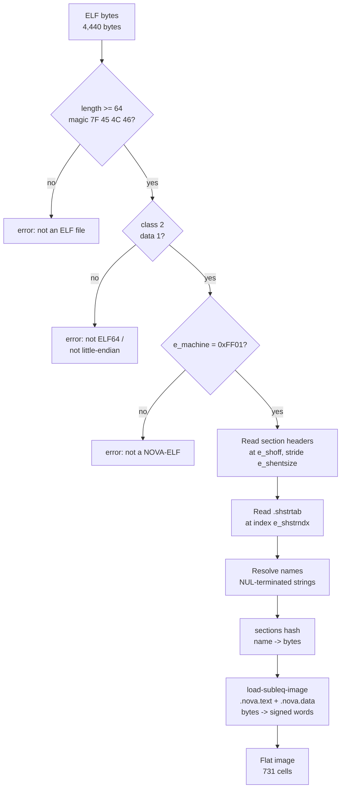

## Packaging pipeline

`package-subleq-image` (`elf/package.rkt`) is the single function that turns a machine image into a NOVA-ELF object. Its signature is `(package-subleq-image image proof-json dag-json)`, and it returns the complete ELF file as bytes. The two string arguments are the JSON payloads for `.nova.proof` and `.nova.dag`; the function places them verbatim and does not validate them.

### The pipeline, step by step

1. **Split.** `image->cells` divides the flat image at `CODE-CELLS` (705). The first 705 cells are the code cells; the remaining 26 are the data cells. The split point is a constant in `package.rkt`, chosen for this image. A different image with a different code size would need a different constant — the function does not discover the split from the image, and the format does not record it except implicitly in the section sizes.
2. **Serialize the halves.** Each half is converted to bytes with `cells->bytes`: 32-bit signed little-endian per cell. The code half becomes 2,820 bytes, the data half 104 bytes.
3. **Build the microprogram descriptor.** The `.nova.urom` content is assembled: a 4-byte version, the 32-byte manifest digest, and four dispatch words. The digest and the words are literals in the function. See the next chapter.
4. **Assemble the section list.** Eight section descriptions are built in the fixed order, with the types, flags, and alignments from the section reference. `.nova.rodata` carries the `SBOX` bytes from `elf.rkt`. `.nova.proof` and `.nova.dag` carry the caller-supplied JSON strings as UTF-8. `.nova.codec` carries the literal string `NOVA-BASE256 v1`. `.note.nova` carries the output of `note-nova-bytes`.
5. **Write.** `nova-elf-write` frames the sections into the ELF file, as documented in [Object construction](#object-construction).

The inverse function, `load-subleq-image`, is documented in [Loader and parser](#loader-and-parser). The two functions are inverses by construction and by test: the packaging splits and serializes, the loading deserializes and concatenates, and the round-trip check in `verify.rkt` confirms the composition is the identity on the v1 image.

### The image equality contract

```
Load(ELF(M)) = M
```

The contract is stated over machine images: `M` is a flat list of exact integers, `ELF(M)` is the object produced by `package-subleq-image`, and `Load` is `load-subleq-image`. The domain on which the contract is established is the v1 image — the 731-cell GF(2^8) multiplication program. The contract has been checked for that image, and only for that image, by the test in `verify.rkt`:

```racket
(define elf-bytes (package-subleq-image image proof-json dag-json))
(define loaded-image (load-subleq-image elf-bytes))
(check "ELF loader preserves image" loaded-image image)
```

where `check` raises an error unless its two arguments are `equal?`. The check compares the full lists, cell for cell, so a single altered cell would fail it. The contract is not a theorem about all images: for an arbitrary list of integers, the packaging would fail at serialization if any value fell outside the 32-bit signed range, and the split point would be wrong for an image whose code section is not 705 cells. The honest statement is that the contract holds for the v1 image, was checked by execution, and would need to be re-established for any other image. The `.nova.proof` section records the claim; the `verify.rkt` output is the evidence.

### The pipeline's upstream and downstream

The pipeline sits between two systems that are not in this repository. Upstream, the lowering engine (`subleq-lowering/gf256.rkt`) produces the image from the Cryptol GF(2^8) specification, and the machine and assembler (`subleq-isa-racket`) define what the image means. Downstream, the NovaDag system ingests the packaged artifact and its manifest as evidence, and a VHDL ROM loader consumes the ROMHEX file to place the image in hardware memory. The packaging function's own header comment in `package.rkt` states this chain directly:

```
Cryptol GF(2^8) spec
  -> External Racket/Rosette compiler (subleq-lowering)
  -> SUBLEQ microcode, 731 cells
  -> NOVA-ELF writer
  -> Custom base encoder
  -> Decode + ELF loader
  -> VHDL SUBLEQ ROM (image)
Artifact manifest -> NovaDag evidence ingestion.
```

## Microprogram metadata: .nova.urom

The `.nova.urom` section is the smallest section in the object and the one most likely to be misunderstood, because its contents belong to a different machine than the one the rest of the object describes. The SUBLEQ machine has no microcode: it executes triples directly. The microprogram descriptor in `.nova.urom` belongs to the outer ROM controller — the VHDL `nested_rom_controller` in the NovaDag tree — which verifies, locks, and dispatches the inner microsequencer that runs the SUBLEQ image. The section is metadata for that controller, serialized inside the object so the artifact carries its own dispatch instructions.

### Byte layout

The section is 52 bytes:

| Offset | Size | Field | Value (v1) |
|---|---|---|---|
| 0 | 4 | Descriptor version, u32 little-endian | 1 |
| 4 | 32 | Manifest digest, raw bytes | `1376fd6b d2433796 55767a5e e22e260d 373bb425 ce437156 2db3fa41 0d64449f` |
| 36 | 4 | Dispatch word 0, u32 little-endian | `0x20000000` |
| 40 | 4 | Dispatch word 1, u32 little-endian | `0x40000000` |
| 44 | 4 | Dispatch word 2, u32 little-endian | `0x30040000` |
| 48 | 4 | Dispatch word 3, u32 little-endian | `0xF0000000` |

The layout is built inline in `package-subleq-image` with a local `u32` helper (unsigned, little-endian) and a literal byte string for the digest. There is no separate constructor function and no parser in this repository.

### The digest

The 32 bytes at offset 4 are the SHA-256 digest of `dag/manifest.json` — the manifest of the outer ROM package, not the manifest of this artifact. The digest is `1376fd6bd243379655767a5ee22e260d373bb425ce4371562db3fa410d64449f`. The outer ROM controller reads these words, concatenates them, and compares the result against the expected digest before it allows the inner machine to start; on a mismatch it fail-stops, the manifest flag stays low, and the inner machine never starts. The digest is a commitment: the artifact asserts which manifest it belongs to, and the controller checks the assertion. Note the distinction between this digest and the image digest (`153be573...`): the image digest identifies the SUBLEQ program, and the manifest digest identifies the outer ROM package that wraps it. They are different objects with different digests, and the `.nova.urom` section is where the two are linked.

### The dispatch words

The four words at offsets 36 through 48 are the controller's program, in order:

| Word | Value | Meaning |
|---|---|---|
| 0 | `0x20000000` | `VERIFY_MANIFEST` — verify the manifest digest before proceeding |
| 1 | `0x40000000` | `LOCK_IMMUTABLE` — lock the inner microsequencer immutable |
| 2 | `0x30040000` | `EXEC_INNER`, inner_pc `0x040` — dispatch execution to inner address `0x040` |
| 3 | `0xF0000000` | `HALT` — stop the controller |

The encoding is the outer ROM's instruction format, not the SUBLEQ format: the top byte selects the operation (`0x20` verify, `0x40` lock, `0x30` execute, `0xF0` halt) and the low bits carry the operand (the inner program counter `0x040` in the execute word). The inner program counter `0x040` is an address in the outer ROM's address space — the bootloader's BIST and dispatch region — not a SUBLEQ word address. The HALT word is a controller instruction, and it must not be confused with a SUBLEQ halt: the SUBLEQ machine halts by driving its program counter out of range, and no SUBLEQ instruction encodes a halt.

### The boundary between metadata and behavior

The descriptor describes behavior; it does not perform it. Nothing in this repository executes the dispatch words, verifies the digest, or locks anything. The controller that does those things is VHDL in the NovaDag tree, and it was verified by GHDL simulation there: the manifest check passes, the lock engages, and the controller produces the 512-bit ciphertext that matches the C reference. What this repository guarantees is narrower: that the 52 bytes in the object are exactly the bytes the packaging function wrote, that they round-trip through the ELF writer and reader unchanged, and that the digest and words match the values recorded in the NovaDag verification. The descriptor is serialized metadata. The behavior it describes belongs to another system, and the evidence for that behavior lives in that system's verification, not in this file.

## The NOVA encoding family

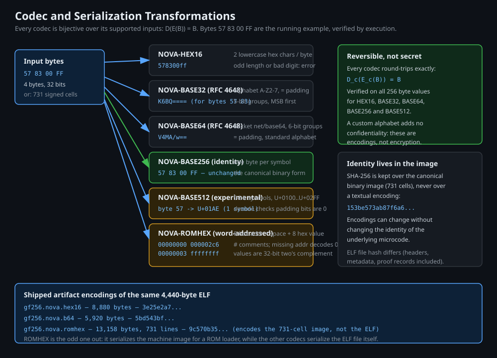

The encoding family (`elf/codec.rkt`) is an independently documented subsystem. It provides six reversible encodings for moving binary data through channels that cannot carry raw bytes: human-readable text, compact text, transport text, the binary identity, an experimental 9-bit symbol alphabet, and word-addressed ROM initialization. The module's header states the governing rule, and it is worth repeating here because it is the most misread sentence in the project: **these are encodings, not encryption. A custom alphabet does not add cryptographic security.** Changing the symbols that represent a byte does not hide the byte. Anyone who can read the alphabet can reverse the encoding, and the alphabets are public, documented in this chapter, and present in the source.

Every codec satisfies the bijectivity contract `D_c(E_c(B)) = B` over its supported inputs, and the contract is checked by execution on all 256 byte values for five of the six codecs. ROMHEX is checked separately, on the 731-cell image, because its input domain is lists of signed words rather than byte strings. The SHA-256 digest is kept over the canonical binary image, never over a textual encoding, so encodings can change without changing the identity of the underlying microcode.

The running example for this chapter is the byte string `57 83 00 FF`. Every encoded form below was produced by executing the codec functions, and the outputs are exact.

### NOVA-HEX16

- **Alphabet.** `0123456789abcdef`, lowercase.
- **Transformation.** Each byte becomes exactly two hex characters: the high nibble first, then the low nibble. `0x57` becomes `57`, `0x83` becomes `83`, `0x00` becomes `00`, `0xFF` becomes `ff`.
- **Example.** `(nova-hex16-encode (bytes #x57 #x83 #x00 #xff))` returns `"578300ff"`. The shipped artifact `gf256.nova.hex16` is the HEX16 encoding of the 4,440-byte ELF: 8,880 characters, SHA-256 `3e25e2a716c55f5b8bab3fb90a35d92b93cfb36e9fdf3f3e6036e8a83448b5b8`.
- **Padding.** None. The output length is always exactly twice the input length.
- **Decoding.** `nova-hex16-decode` accepts both lowercase and uppercase hex digits. It raises an error on an odd-length string (`"odd-length hex string"`) and on any character that is not a hex digit (`"bad hex digit: ..."`).
- **Input domain.** Arbitrary byte strings.
- **Use.** Human-readable inspection, hex dumps, and contexts where a byte must be visible as text.

### NOVA-BASE32

- **Alphabet.** RFC 4648 base32: `ABCDEFGHIJKLMNOPQRSTUVWXYZ234567`, with `=` padding.
- **Transformation.** The input bytes are expanded to a bit stream, most-significant bit first, then regrouped into 5-bit symbols. The final group is zero-padded on the right to 5 bits. Padding `=` characters are appended so the output length is a multiple of 8 characters.
- **Example.** `(nova-base32-encode (bytes #x57 #x83))` returns `"K6BQ===="`. The 16 input bits regroup as 01010 (K), 11110 (6), 00001 (B), 10000 (Q), with four `=` pads.
- **Decoding.** `nova-base32-decode` strips `=` characters, maps each character through the alphabet (raising `"bad base32 char: ..."` for anything outside it), expands to bits, and takes the whole bytes — `floor(bit-count / 8)`. The sub-byte tail bits are dropped, which means decoding is not injective on the final partial group: both `"K6BQ===="` and `"K6DQ===="` decode to the same two bytes, because the differing bit falls in the dropped tail. Encoding is injective; decoding recovers the bytes, not the padding.
- **Input domain.** Arbitrary byte strings.
- **Use.** Compact textual representation where the alphabet must avoid characters that are awkward in identifiers or filenames.

### NOVA-BASE64

- **Alphabet.** RFC 4648 base64, standard alphabet with `=` padding.
- **Transformation.** Delegated to Racket's `net/base64`: `base64-encode` with an empty line separator, so the output is a single line with no line breaks. 6-bit groups, most-significant bit first.
- **Example.** `(nova-base64-encode (bytes #x57 #x83 #x00 #xff))` returns `"V4MA/w=="`. The shipped artifact `gf256.nova.b64` is the BASE64 encoding of the 4,440-byte ELF: 5,920 characters, SHA-256 `5bd543bf6badacd0043c48885f61ef35980cc08c6a6c8479eb659a804309a38e`.
- **Decoding.** `nova-base64-decode` delegates to `base64-decode`. Malformed input raises the underlying Racket error.
- **Input domain.** Arbitrary byte strings.
- **Use.** Transport and storage through text channels; the most compact of the standard text encodings here.

### NOVA-BASE256

- **Alphabet.** None. The encoding is the identity function.
- **Transformation.** `(nova-base256-encode bs)` returns `bs` unchanged, and `(nova-base256-decode bs)` returns `bs` unchanged.
- **Example.** The bytes `57 83 00 FF` encode as themselves.
- **Meaning.** BASE256 is the name for the canonical binary form. It exists so that the codec family has a uniform interface — every encoding has an encode and a decode, and the identity is the encoding that does nothing — and so that `.nova.codec` can record `NOVA-BASE256 v1` as the statement that the canonical form is the raw bytes. It is not a compression or a transformation; it is the baseline against which the other encodings are measured.
- **Input domain.** Arbitrary byte strings.
- **Use.** The canonical form, and the reference point for the bijectivity contract.

### NOVA-BASE512

- **Alphabet.** 512 symbols: Unicode code points U+0100 through U+02FF (Latin Extended-A and Latin Extended-B), in order. Symbol index 0 is U+0100 (Ā), index 255 is U+01FF (ȿ), index 511 is U+02FF (˿).
- **Transformation.** The input bytes are expanded to a bit stream, most-significant bit first, then regrouped into 9-bit symbols. The final group is zero-padded on the right to 9 bits. Each symbol is emitted as the alphabet character at that index.
- **Example.** `(nova-base512-encode (bytes #x57))` returns the single character U+01AE (Ʈ, code point 430). The byte `0x57` is 8 bits, `01010111`; padded on the right with one zero bit it becomes the 9-bit group `010101110`, which is 174; the alphabet character at index 174 is U+0100 + 174 = U+01AE.
- **Decoding.** `nova-base512-decode` maps each character to its alphabet index (raising `"bad base512 char"` for anything outside U+0100..U+02FF), expands to bits, and verifies that the trailing padding bits — the bits beyond the largest whole number of bytes — are all zero, raising `"nonzero padding bit"` otherwise. This check is what makes the encoding unambiguous despite the alphabet being arbitrary: a decoder that did not verify the padding could accept two different strings for the same bytes. The padding verification is the one place in the codec family where the decoder checks more than the alphabet.
- **Status.** Experimental. The 9-bit symbol alphabet and the padding rule are specified, and the codec round-trips on all 256 byte values, but it has not been used in a shipped artifact. The shipped artifacts use HEX16, BASE64, and ROMHEX. BASE512 is documented as a specified and tested encoding, not as a deployed one.
- **Input domain.** Arbitrary byte strings.
- **Use.** Experiments in denser-than-base64 textual representation, where a 9-bit symbol carries more than a byte per character.

### Codec comparison

| Codec | Symbol width | Alphabet | Output per input byte | Padding | Decode strictness | Status |
|---|---|---|---|---|---|---|
| NOVA-HEX16 | 4 bits | `0-9a-f` | 2 chars | none | odd length / bad digit: error | Shipped |
| NOVA-BASE32 | 5 bits | `A-Z2-7` | 1.6 chars | `=` to multiple of 8 | bad char: error; tail bits dropped | Tested |
| NOVA-BASE64 | 6 bits | RFC 4648 | 1.33 chars | `=` | Racket `base64-decode` errors | Shipped |
| NOVA-BASE256 | 8 bits | — (identity) | 1 byte | none | none (identity) | Canonical |
| NOVA-BASE512 | 9 bits | U+0100..U+02FF | 0.89 chars | right zero-pad to 9 bits | bad char / nonzero pad bit: error | Experimental |
| NOVA-ROMHEX | 32 bits | `0-9a-f` | ~18 chars / word | none | bad line / bad hex: error | Shipped |

The "output per input byte" column is the asymptotic expansion: HEX16 doubles the size, BASE32 expands by 8/5, BASE64 by 4/3, BASE256 is neutral, BASE512 compresses textually to 8/9 of a character per byte (at the cost of non-ASCII output), and ROMHEX expands the most because it carries an explicit address with every word. Expansion is not a defect: each encoding pays for a different property — readability, compactness, transport safety, canonicity, density, or addressability.

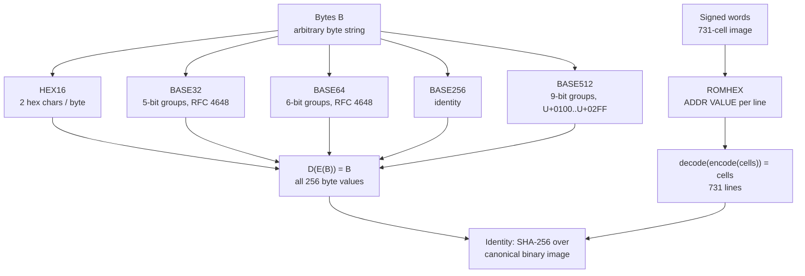

## ROMHEX

NOVA-ROMHEX is the one codec whose input is not bytes but signed words, and the one whose output is not a single string of symbols but a line-oriented text file. It exists for a single purpose: initializing a ROM in hardware. A ROM loader reads an address and a value per line and writes the value into that address; ROMHEX is the text format for that conversation.

### Line grammar

Each line is one of three things:

- **A word line:** eight lowercase hex digits for the word address, a single space, eight lowercase hex digits for the 32-bit value, and a newline. Example: `00000000 000002c6`.
- **A comment line:** a line starting with `#` (after trimming whitespace). Comments are ignored by the decoder.
- **A blank line:** an empty line, or a line containing only whitespace. Blank lines are ignored by the decoder.

The address is explicit on every line, so the format is word-addressed and unambiguous: a line says where its value goes, and the order of the lines does not matter. The value is the 32-bit two's complement representation of the signed word, lowercase hex, zero-padded to eight digits. The value -1 encodes as `ffffffff`; the value 729 encodes as `000002d9`; the value 0 encodes as `00000000`.

### Encoding

`nova-romhex-encode` takes a list of exact integers — the cells, in address order starting at address 0 — and emits one line per cell. The address is the cell's index, formatted as eight lowercase hex digits. The value is reduced modulo 2^32 and formatted as eight lowercase hex digits. The shipped artifact `gf256.nova.romhex` is the encoding of the 731-cell image: 731 lines, 13,158 bytes, SHA-256 `9c570b3596fe01039c72545064036ec32a7ee693a1c957e2b4e3380e944d422b`. Its first three lines are:

```
00000000 000002c6
00000001 000002c6
00000002 00000003
```

Those are word addresses 0, 1, and 2 holding the values 710, 710, and 3 — the first instruction of the image, `(710, 710, 3)`.

### Decoding

`nova-romhex-decode` takes the text and returns a dense list of signed words. It splits the text on newlines, trims each line, skips blank lines and comment lines, and requires every remaining line to have exactly two whitespace-separated parts, or it raises `"bad line: ..."`. It parses both parts as hex, raising `"bad hex in line: ..."` if either fails. The value is converted from unsigned 32-bit to signed: if it is greater than or equal to 2^31, 2^32 is subtracted. Then it returns the dense list from address 0 through the maximum address present, filling any missing address with 0.

Three properties of the decoder deserve attention:

1. **Missing addresses decode to 0.** A ROMHEX file that lists only address 3 decodes to the four-element list `(0 0 0 -1)`, not to a sparse map. The format is dense on decode even though it is sparse-capable on the wire. A producer that omits a zero-valued cell and a producer that writes it explicitly produce the same decoded image.
2. **Out-of-order lines are accepted.** Because each line carries its own address and the decoder sorts the addresses, the lines can appear in any order and still decode to the same image. The encoder always emits them in order, but the decoder does not require it.
3. **Duplicate addresses are silently overwritten.** If two lines give different values for the same address, the later line in the file wins, because the decoder stores values in a hash keyed by address. There is no duplicate detection.

### Round trip

The round-trip property is `decode(encode(cells)) = cells`, checked in `verify.rkt` on the 731-cell image:

```racket
(define romhex-text (nova-romhex-encode image))
(define romhex-cells (nova-romhex-decode romhex-text))
(check "ROMHEX round-trip" romhex-cells image)
```

The property holds for the encoder's output, which is dense and in order. It does not hold for arbitrary ROMHEX text: a file with missing addresses decodes to a dense list with zeros filled in, which is a different list from the sparse input, and a file with duplicate addresses decodes to the last value written. The round-trip claim is about the codec pair, not about every text file that happens to parse.

## Racket API reference

This chapter documents the exported interface of each module. Function names, argument orders, and return types are taken from the `provide` forms and the function definitions. Preconditions and error behavior are taken from the code.

### elf.rkt — NOVA-ELF v1 writer and parser

| Export | Input | Output | Contract |
|---|---|---|---|
| `EM-NOVA-SUBLEQ` | — | `#xFF01` | The machine identifier constant. |
| `NOVA-ELF-VERSION` | — | `1` | The format version constant. |
| `SBOX` | — | 256 bytes | The AES S-box, standard order. |
| `cells->bytes` | List of exact integers | Bytes | Each cell as 32-bit signed little-endian. Raises if a cell is outside the 32-bit signed range. |
| `note-nova-bytes` | — | 92 bytes | The `.note.nova` content: namesz 4, descsz 74, type 1, name `NOVA`, description string. |
| `nova-elf-write` | List of `(name type flags align content-bytes)` | Bytes | The complete ELF file. Caller supplies the eight NOVA sections; the writer adds NULL and `.shstrtab`. |
| `nova-elf-read` | Bytes | Hash | `'type`, `'machine`, `'entry`, `'shnum`, `'sections` (hash name → bytes). Raises on bad magic, non-ELF64, non-little-endian, or wrong `e_machine`. |
| `nova-elf-sections` | Parsed hash from `nova-elf-read` | Hash | The `'sections` hash. |

**Preconditions.** `nova-elf-write` expects each section description to be a five-element list with a string name, exact-integer type, flags, and alignment, and a byte string as content. It does not validate these; a malformed description produces a malformed file or a Racket error during construction. `nova-elf-read` expects at least 64 bytes and a well-formed header; see [Loader and parser](#loader-and-parser) for the exact checks and the deliberate omissions.

**Invariants.** The writer always produces a file whose section header table is 8-byte aligned, whose `e_shnum` equals the number of sections including NULL and `.shstrtab`, and whose `e_shstrndx` points at `.shstrtab`. The reader always returns section contents sliced exactly as the section headers describe.

### codec.rkt — the six base encodings

| Export | Input | Output | Contract |
|---|---|---|---|
| `codec-names` | — | List of 6 strings | `"NOVA-HEX16"`, `"NOVA-BASE32"`, `"NOVA-BASE64"`, `"NOVA-BASE256"`, `"NOVA-BASE512"`, `"NOVA-ROMHEX"`. |
| `nova-hex16-encode` | Bytes | String | Two lowercase hex chars per byte. |
| `nova-hex16-decode` | String | Bytes | Accepts upper- and lowercase. Errors on odd length or bad digit. |
| `nova-base32-encode` | Bytes | String | RFC 4648, `=` padded. |
| `nova-base32-decode` | String | Bytes | Strips `=`; errors on bad char; drops sub-byte tail bits. |
| `nova-base64-encode` | Bytes | String | RFC 4648 via `net/base64`, single line. |
| `nova-base64-decode` | String | Bytes | Via `net/base64`; malformed input raises the underlying error. |
| `nova-base256-encode` | Bytes | Bytes | Identity. |
| `nova-base256-decode` | Bytes | Bytes | Identity. |
| `nova-base512-encode` | Bytes | String | 9-bit groups, U+0100..U+02FF, right zero-pad. |
| `nova-base512-decode` | String | Bytes | Errors on bad char or nonzero padding bit. |
| `nova-romhex-encode` | List of exact integers | String | One `ADDR VALUE` line per cell, address = index. |
| `nova-romhex-decode` | String | List of exact integers | Dense list from address 0, missing = 0. Errors on bad lines or bad hex. |

**Preconditions.** The byte codecs expect byte strings; passing a non-byte value raises a Racket contract error from the byte operations. The ROMHEX encoder expects exact integers; a value outside the 32-bit signed range is reduced modulo 2^32, which is a silent wrap — the encoder does not raise. The ROMHEX decoder expects the line grammar documented above.

**Invariants.** For the five byte codecs, `decode(encode(B)) = B` for every byte string `B`. For ROMHEX, `decode(encode(cells)) = cells` for every list of cells the encoder produces. BASE512 decoding verifies padding bits are zero; BASE32 decoding does not verify its tail bits.

### package.rkt — the packaging pipeline

| Export | Input | Output | Contract |
|---|---|---|---|
| `CODE-CELLS` | — | `705` | The code/data split point for the v1 image. |
| `DATA-CELLS` | — | `26` | The data cell count for the v1 image. |
| `image->cells` | Flat image (list) | Two values: code cells, data cells | Splits at cell 705. |
| `cells->image` | Code cells, data cells | Flat image (list) | Concatenates in order. |
| `package-subleq-image` | Image, proof JSON string, DAG JSON string | Bytes | The complete NOVA-ELF object. |
| `load-subleq-image` | ELF bytes | Flat image (list) | The inverse of packaging for the v1 image. |

**Preconditions.** `package-subleq-image` expects a flat list of exact integers whose length is at least 705, with all values in the 32-bit signed range; a shorter image produces a short code section and an empty data section rather than an error, and an out-of-range value raises during serialization. The two JSON strings are placed verbatim and are not validated — a malformed string produces a well-formed ELF file containing malformed JSON. `load-subleq-image` expects ELF bytes for an object containing `.nova.text` and `.nova.data`; a missing section raises a hash error.

**Invariants.** `cells->image` is the inverse of `image->cells` on any list. `load-subleq-image` is the inverse of `package-subleq-image` on the v1 image, as checked by `verify.rkt`. The `.nova.urom` descriptor is built from literals in `package-subleq-image` — the version, digest, and dispatch words are constants in the function, not derived from the image.

### verify.rkt — the verification contract

`verify.rkt` exports nothing. It is a script: requiring it or running it executes the checks. Its top-level definitions are the canonical image (`image`, `labels`, `in-a-addr`, `in-b-addr`, `out-r-addr`), the `proof-json` and `dag-json` strings, and the `check` helper, which prints `ok <name>` on success and raises an error on failure. The checks run in order: five codec bijectivity checks, the ELF round trip, three ELF-through-codec checks, the exhaustive GF semantics check, and the ROMHEX round trip. The script then writes the four artifacts to `artifact/` and prints their sizes. See [Verification contracts](#verification-contracts) for the full list and [Reproducing the project checks](#reproducing-the-project-checks) for how to run it.

## Detailed usage examples

Every example in this chapter was executed against the code in this repository (Racket v8.15). The outputs shown are the actual outputs. Examples that require the sibling trees (`subleq-isa-racket`, `subleq-lowering`) say so; the others run against this repository alone.

### Encode and decode bytes

In a Racket REPL or script, with the repository root as the working directory:

```racket
(require "elf/codec.rkt")
(nova-hex16-encode (bytes #x57 #x83 #x00 #xff))
;; "578300ff"
(nova-hex16-decode "578300ff")
;; #"\W\203\0\377"
(nova-base64-encode (bytes #x57 #x83 #x00 #xff))
;; "V4MA/w=="
(nova-base32-encode (bytes #x57 #x83))
;; "K6BQ===="
(nova-base512-encode (bytes #x57))
;; "Ʈ"  (one character, U+01AE)
(nova-base256-encode (bytes #x57 #x83))
;; #"\W\203"  (identity)
```

The decoded byte strings print with Racket's byte-string notation: `#"\W\203\0\377"` is the four bytes `0x57 0x83 0x00 0xFF`. The BASE512 result is a single Unicode character; in a terminal that cannot display it, use `(char->integer (string-ref (nova-base512-encode (bytes #x57)) 0))`, which returns `430`.

### Encode and decode a ROM image

```racket
(require "elf/codec.rkt")
(nova-romhex-encode '(710 710 3 -1))
;; "00000000 000002c6\n00000001 000002c6\n00000002 00000003\n00000003 ffffffff\n"
(nova-romhex-decode "00000003 ffffffff\n")
;; '(0 0 0 -1)
```

The second example shows the dense-fill rule: a file that lists only address 3 decodes to a four-element list with zeros filled in for addresses 0 through 2.

### Write and read an ELF object

```racket
(require "elf/elf.rkt")
(define sections
  (list (list ".nova.text" 1 6 4 (cells->bytes '(710 710 3)))
        (list ".nova.data" 1 3 4 (cells->bytes '(0)))
        (list ".nova.rodata" 1 2 1 SBOX)
        (list ".nova.urom" 1 2 4 (bytes 1 0 0 0))
        (list ".nova.proof" 1 0 1 #"{}")
        (list ".nova.codec" 1 0 1 #"NOVA-BASE256 v1")
        (list ".nova.dag" 1 0 1 #"{}")
        (list ".note.nova" 7 0 4 (note-nova-bytes))))
(define elf-bytes (nova-elf-write sections))
(define parsed (nova-elf-read elf-bytes))
(hash-ref parsed 'machine)   ;; 65281  (#xFF01)
(hash-ref parsed 'entry)     ;; 0
(hash-ref parsed 'shnum)     ;; 10
(sort (hash-keys (nova-elf-sections parsed)) string<?)
;; '(".note.nova" ".nova.codec" ".nova.dag" ".nova.data" ".nova.proof"
;;   ".nova.rodata" ".nova.text" ".nova.urom" ".shstrtab")
```

This example builds a minimal object with a one-instruction program. The writer accepts any section list; the values above are the v1 types, flags, and alignments. Note that `nova-elf-write` adds the NULL section and `.shstrtab` itself, so the caller's list has eight entries and the file has ten sections.

### Package and load the v1 image

This example requires the sibling trees (see [Reproducing the project checks](#reproducing-the-project-checks)):

```racket
(require "elf/package.rkt"
         "elf/verify.rkt")  ; verify.rkt runs the checks on require; use only package.rkt for a quiet load
```

In practice, load the image through `subleq-lowering` and call the two pipeline functions directly:

```racket
(require "elf/package.rkt"
         "../subleq-lowering/gf256.rkt"
         "../subleq-isa-racket/subleq/asm.rkt")
(define-values (image labels) (assemble/labels (gf-mul-items)))
(define elf-bytes (package-subleq-image image "{}" "{}"))
(bytes-length elf-bytes)              ;; 4440
(equal? (load-subleq-image elf-bytes) image)  ;; #t
```

The proof and DAG JSON strings are `{}` in this example; the shipped artifact uses the full evidence strings from `verify.rkt`, which change the `.nova.proof` and `.nova.dag` section sizes and therefore the file layout. The 4,440-byte size holds for the shipped strings, not for arbitrary ones.

### Run the machine on the loaded image

```racket
(require "elf/package.rkt"
         "../subleq-lowering/gf256.rkt"
         "../subleq-isa-racket/subleq/machine.rkt"
         "../subleq-isa-racket/subleq/asm.rkt")
(define-values (image labels) (assemble/labels (gf-mul-items)))
(define loaded (load-subleq-image (package-subleq-image image "{}" "{}")))
(define m (make-machine))
(machine-load! m loaded)
(vector-set! (machine-mem m) (hash-ref labels 'in-a) 87)
(vector-set! (machine-mem m) (hash-ref labels 'in-b) 131)
(machine-run m)   ;; 'halted
(vector-ref (machine-mem m) (hash-ref labels 'out-r))  ;; 193
```

This is the same sequence `verify.rkt` runs for each of the 65,536 input pairs, reduced to one pair.

## Binary inspection

### With the Racket reader

The most precise way to inspect an object is the reader itself, because it applies the same checks the loader applies:

```racket
(require "elf/elf.rkt")
(define data (call-with-input-file "artifact/gf256.nova.elf" port->bytes))
(define parsed (nova-elf-read data))
(hash-ref parsed 'type)     ;; 1
(hash-ref parsed 'machine)  ;; 65281
(hash-ref parsed 'entry)    ;; 0
(hash-ref parsed 'shnum)    ;; 10
(define secs (nova-elf-sections parsed))
(bytes-length (hash-ref secs ".nova.text"))  ;; 2820
(bytes-length (hash-ref secs ".nova.data"))  ;; 104
(hash-ref secs ".nova.codec")               ;; #"NOVA-BASE256 v1"
```

### With readelf

Because the file is a well-formed ELF64 object, standard tools parse its header and section table:

```
readelf -h artifact/gf256.nova.elf
readelf -S artifact/gf256.nova.elf
```

`readelf -h` reports `Type: REL (Relocatable file)` and `Machine: <unknown: 0xff01>` — the unknown machine is expected; no generic tool knows `0xFF01`. `readelf -S` lists the ten sections with their types, addresses (all 0), offsets, and sizes, matching the layout table in [The ELF64 container](#the-elf64-container). `readelf -x .nova.urom artifact/gf256.nova.elf` dumps the 52-byte descriptor as hex, and `readelf -p .nova.proof` prints the proof JSON as a string. These commands were not run as part of the verification for this manual — `readelf` is not installed on the authoring machine — so they are documented as the standard invocations, not as reproduced output. If `readelf` is unavailable, `xxd` or `od` on the file with the offset table gives the same information byte by byte.

### With xxd

The header can be read directly. The first 64 bytes of the shipped file begin:

```
7f45 4c46 0201 0100 0000 0000 0000 0000
0100 01ff 0100 0000 0000 0000 0000 0000
0000 0000 0000 0000 d80e 0000 0000 0000
0000 0000 4000 0000 0000 0000 4000 0a00
0900
```

Reading it as the header table says: magic `7F 45 4C 46`, class 2, data 1, version 1, OSABI 0, then `e_type` 1, `e_machine` `0xFF01`, `e_version` 1, `e_entry` 0, `e_phoff` 0, `e_shoff` `0xED8` (3,800), `e_flags` 0, `e_ehsize` 64, `e_phentsize` 0, `e_phnum` 0, `e_shentsize` 64, `e_shnum` 10, `e_shstrndx` 9. The `.nova.text` section starts at file offset 64, immediately after the header, with the bytes `C6 02 00 00` — the little-endian encoding of 710.

### Checking digests

```
sha256sum artifact/*
```

Expected output, matching `STATUS.md` and `manifest.json`:

```
5bd543bf6badacd0043c48885f61ef35980cc08c6a6c8479eb659a804309a38e  artifact/gf256.nova.b64
4c2605a56c05fab29b5f80e6244a84791b5db7a2021511203c0b6d6b4b79057f  artifact/gf256.nova.elf
3e25e2a716c55f5b8bab3fb90a35d92b93cfb36e9fdf3f3e6036e8a83448b5b8  artifact/gf256.nova.hex16
9c570b3596fe01039c72545064036ec32a7ee693a1c957e2b4e3380e944d422b  artifact/gf256.nova.romhex
```

`manifest.json` itself is not checksummed by the script; its SHA-256 was computed for this manual as `9f8e1183c4c714f71a2a71fb26ff505a853a7406d2dd8be6ef8b20dde9bd93b7`. The manifest is an authored record, not a generated one, and its digest is a convenience, not a contract term.

## Verification contracts

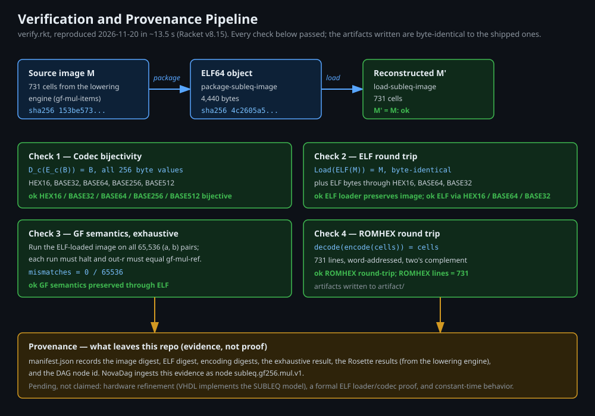

The verification contract is `elf/verify.rkt`. It is a script, not a library: running it executes the checks, prints one `ok` line per passing check, and raises an error on the first failure. This chapter states precisely what each check establishes, what it does not establish, and where the evidence lives. The distinction between a check, a proof, and a metadata record is maintained throughout: a check is a program that ran and passed; a proof is a formal argument, which in this project lives in the lowering engine's Rosette results and is recorded here, not reproduced here; a metadata record is a string in a section that asserts a result.

### Verification matrix

| Property | Method | Input domain | Expected result | Evidence location |
|---|---|---|---|---|
| HEX16 bijectivity | `nova-hex16-decode(nova-hex16-encode(B)) = B` | All 256 byte values (one 256-byte input) | Equal | `verify.rkt` check 1 |
| BASE32 bijectivity | `nova-base32-decode(nova-base32-encode(B)) = B` | All 256 byte values | Equal | `verify.rkt` check 1 |
| BASE64 bijectivity | `nova-base64-decode(nova-base64-encode(B)) = B` | All 256 byte values | Equal | `verify.rkt` check 1 |
| BASE256 bijectivity | `nova-base256-decode(nova-base256-encode(B)) = B` | All 256 byte values | Equal (identity) | `verify.rkt` check 1 |
| BASE512 bijectivity | `nova-base512-decode(nova-base512-encode(B)) = B` | All 256 byte values | Equal | `verify.rkt` check 1 |
| ELF loader preserves image | `load-subleq-image(package-subleq-image(M)) = M` | The 731-cell v1 image | Equal, cell for cell | `verify.rkt` check 2 |
| ELF via HEX16 | `decode(encode(ELF)) = ELF` | The 4,440-byte v1 object | Equal | `verify.rkt` check 2 |
| ELF via BASE64 | `decode(encode(ELF)) = ELF` | The 4,440-byte v1 object | Equal | `verify.rkt` check 2 |
| ELF via BASE32 | `decode(encode(ELF)) = ELF` | The 4,440-byte v1 object | Equal | `verify.rkt` check 2 |
| GF semantics from ELF image | Run loaded image on all `(a, b)` | All 65,536 pairs, `a, b` in 0..255 | 0 mismatches, every run halts | `verify.rkt` check 3 |
| ROMHEX round trip | `decode(encode(cells)) = cells` | The 731-cell v1 image | Equal | `verify.rkt` check 4 |
| Word-width faithfulness | Direct range inspection | Image values -1..729; sampled execution -256..510 (reported) | Inside 32-bit signed range | `STATUS.md`, image inspection |

### What the checks establish

**Codec bijectivity.** The five byte codecs are bijective on the tested input: a single 256-byte input containing every byte value 0..255, encoded and decoded, returns the same bytes. This is an exhaustive check over the byte alphabet, not a sampled one — every possible byte value appears in the input. It does not test every possible byte string (there are infinitely many), but bijectivity over the alphabet plus the bit-level construction of the encoders is the property the contract needs: if every byte round-trips, and the encoders are deterministic bit regroupings, then every string round-trips. The claim is stated as a tested property, not a theorem.

**ELF round trip.** The image written to ELF and read back is byte-identical — the check compares the full 731-cell lists with `equal?`. The ELF file itself also round-trips through HEX16, BASE64, and BASE32. Together these establish that the packaging is lossless for this image and that the text encodings are lossless for this object.

**GF semantics.** The strongest check. The ELF-loaded image is executed on all 65,536 input pairs, each run must halt, and each output must equal the reference. Zero mismatches means the packaged program computes the same function as the reference on the full input domain. This is an exhaustive functional check, not a sampled one. It does not check that the program is the intended lowering in any deeper sense — that is the Rosette result from the lowering engine, recorded in `.nova.proof` — but it does check that the program that comes out of the ELF file computes correctly on every input.

**ROMHEX round trip.** The 731-cell image encoded as ROMHEX and decoded returns the same 731 cells. The check also prints the line count (731), confirming the one-line-per-word structure.

**Word-width faithfulness.** The image values span -1 to 729, verified by direct inspection of the assembled image. The sampled execution range -256..510 is a previously reported measurement from the lowering baseline; a 16-by-16 sampled grid run for this manual observed a minimum of -254 and a maximum of 729 (the maximum includes static image cells, so it is not directly comparable to the reported execution range). The claim that matters for the format is the image range, which is verified here; the execution range is reported as a prior measurement and labeled as such.

### What is not established

- **No formal proof of the loader or codec.** The ELF loader and codec are verified by round-trip execution in Racket. A separate proof obligation covers them; that obligation is registered, not discharged. The `.nova.proof` section records results; it is not itself a proof.
- **No hardware refinement.** The claim that a VHDL implementation of the SUBLEQ machine executes the same transitions as the reference model is a pending obligation in the DAG node record. The ROMHEX file is the input to that hardware, not evidence that the hardware is correct.
- **No constant-time behavior.** The step count varies from 333 to 7,978 by input. Functional correctness does not establish resistance to timing or power analysis.
- **No robustness proof for the parser.** The reader's checks are enumerated in [Loader and parser](#loader-and-parser); the properties it does not check are enumerated there too. A malformed file raises an error rather than producing a wrong image, but that is a runtime property, not a verified one.
- **No claim about other images.** Every check is about the v1 image (and, for the codecs, about the byte alphabet). A different image would need its own run of the contract.

### Verification relationships

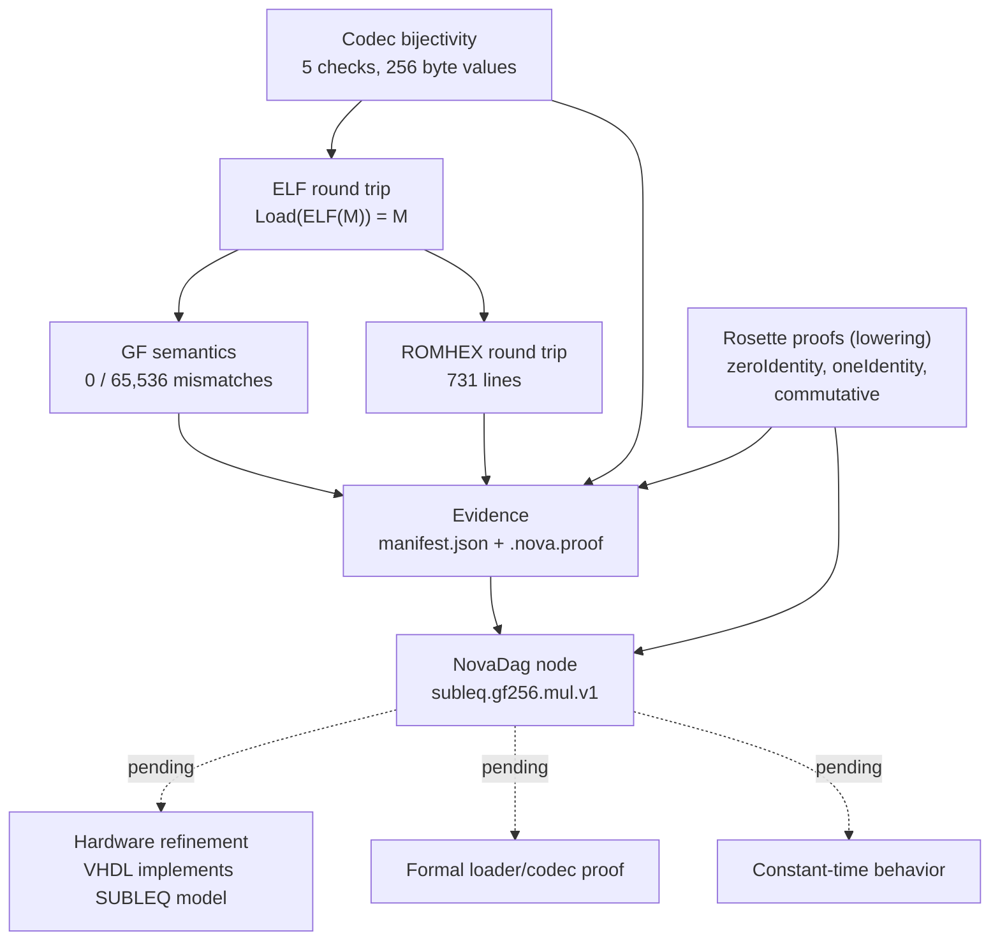

## Reproducing the project checks

### The layout requirement

`elf/package.rkt` and `elf/verify.rkt` use relative requires that resolve against the repository root:

```racket
(require "../subleq-isa-racket/subleq/machine.rkt"
         "../subleq-isa-racket/subleq/asm.rkt")
```

and `verify.rkt` additionally requires `../subleq-lowering/gf256.rkt`. From `elf/`, `..` is the repository root, so the requires resolve to `subleq-isa-racket/` and `subleq-lowering/` inside the root. A bare clone does not contain those directories, and the script fails immediately:

```
elf/package.rkt:25:9: cannot open module file
  module path: .../nova-elf/subleq-isa-racket/subleq/machine.rkt
  system error: no such file or directory
```

This is a real constraint of the current tree, not a documentation gap: the verification contract depends on two sibling systems (the machine/assembler and the lowering engine) that live outside this repository. The modules that do not depend on them — `elf/elf.rkt` and `elf/codec.rkt` — load and run standalone in a bare clone.

### How the reproduction in this manual was performed

The checks were reproduced on 2026-11-20 with Racket v8.15 by copying the repository to a scratch directory and providing the sibling trees as symbolic links inside the copy, without modifying the repository:

```
cp -r nova-elf /tmp/nova-elf-run
ln -s ~/workspace/subleq-isa-racket /tmp/nova-elf-run/subleq-isa-racket
ln -s ~/workspace/subleq-lowering /tmp/nova-elf-run/subleq-lowering
cd /tmp/nova-elf-run
racket elf/verify.rkt
```

The run took about 13.5 seconds and produced the output shown in [Quick start](#quick-start): all eleven `ok` lines, `ELF file size = 4440 bytes`, `GF from ELF-loaded image: mismatches = 0 / 65536`, and `ROMHEX lines = 731`. The regenerated artifacts in the scratch directory were byte-identical to the shipped artifacts — the same four SHA-256 digests — which confirms that the shipped files are the output of this script and not hand-edited.

The scratch directory was deleted after the run. No file in the repository was modified by the reproduction.

### Commands and their prerequisites

| Command | Requires | What it proves |
|---|---|---|
| `racket elf/verify.rkt` | Sibling trees in place | The full contract: 14 checks |
| `racket -e '(require "elf/codec.rkt")'` | Nothing beyond Racket | The codec module loads |
| `racket -e '(require "elf/elf.rkt")'` | Nothing beyond Racket | The ELF module loads |
| `sha256sum artifact/*` | The shipped artifacts | The files match the recorded digests |
| `racket elf/verify.rkt` (bare clone) | — | Fails on the missing `subleq-isa-racket` module |

### Reproducing individual checks

Each check group can be reproduced in isolation by requiring the modules and calling the functions directly, as shown in [Detailed usage examples](#detailed-usage-examples). The codec checks need only `elf/codec.rkt`. The ELF round trip needs `elf/package.rkt` and therefore the sibling trees. The GF semantics check needs the machine, the assembler, and the lowering engine as well. There is no separate test suite and no test runner: `verify.rkt` is the test suite, and its output is the test report.

## Proof and provenance representation

This project keeps three different kinds of assurance apart, and confusing them is the fastest way to misread the repository.

**A check** is a program that ran and passed. The eleven `ok` lines from `verify.rkt` are checks. They are the strongest claims in this repository, because they are reproducible: anyone with the sibling trees and Racket v8.15 can run the script and see the same output. The check names say exactly what was checked, and the matrix in [Verification contracts](#verification-contracts) states the input domain for each one.

**A proof** is a formal argument that a property holds for all inputs in some domain, discharged by a proof assistant or solver. This repository contains no proofs. The Rosette/Z3 results recorded in `.nova.proof` — zeroIdentity, oneIdentity, commutativity — are proofs, but they were discharged by the lowering engine in `subleq-lowering`, not by this repository. This repository records their results as JSON strings. The ELF loader and codec proof obligation is registered and undischarged. Nothing in this manual should be read as claiming a formal proof of the format.

**A metadata record** is a string in a section that asserts a result. `.nova.proof` and `.nova.dag` are metadata records. They are useful because they travel with the object: anyone holding the ELF file can read what was checked and where the artifact came from, without consulting an external database. They are not evidence by themselves — the evidence is the `verify.rkt` output and the lowering engine's own records — and a metadata record that asserted a false result would be a lie in a file, not a failed check. The format does not defend against that; it assumes the packager is honest, and the DAG's job is to hold the packager accountable.

The manifest (`artifact/manifest.json`) is the provenance record for the v1 artifact. It is a single JSON object with six keys:

| Key | Content |
|---|---|
| `artifact` | `"subleq.gf256.mul.v1"` — the artifact id |
| `canonical_image` | Cell count (731) and the image SHA-256 |
| `codec` | Identifier `"NOVA-BASE256 v1"` and version 1 |
| `dag_node` | `"subleq.gf256.mul.v1"` — the NovaDag node id |
| `elf` | Byte count (4,440), SHA-256, version `"NOVA-ELF v1"` |
| `encodings` | Per-encoding byte counts, line count (ROMHEX), and SHA-256 digests |
| `lineage` | Parents (`cryptol.gf256.mul.v1`) and transformation (`lower-gf256-to-subleq`) |
| `proof` | The exhaustive result, the ROMHEX result, the Rosette results, and the loader claim |
| `verification` | Status `"proved (within the tested machine model)"` and `hardware_refinement: "pending"` |

The status string `"proved (within the tested machine model)"` is the careful formulation: the artifact is proved in the sense that its functional behavior was checked exhaustively against the reference machine model, and the qualification is that the model is the tested one — the Racket reference machine — not a hardware implementation. The hardware refinement is listed as pending in the same object, so the manifest does not overclaim.

## Relationship to NovaDag

NovaDag is the transformation DAG that records the artifact. This repository is the serialization tooling that produces the artifact. The relationship is one-directional and deliberately narrow: this repository produces bytes and evidence; NovaDag records them.

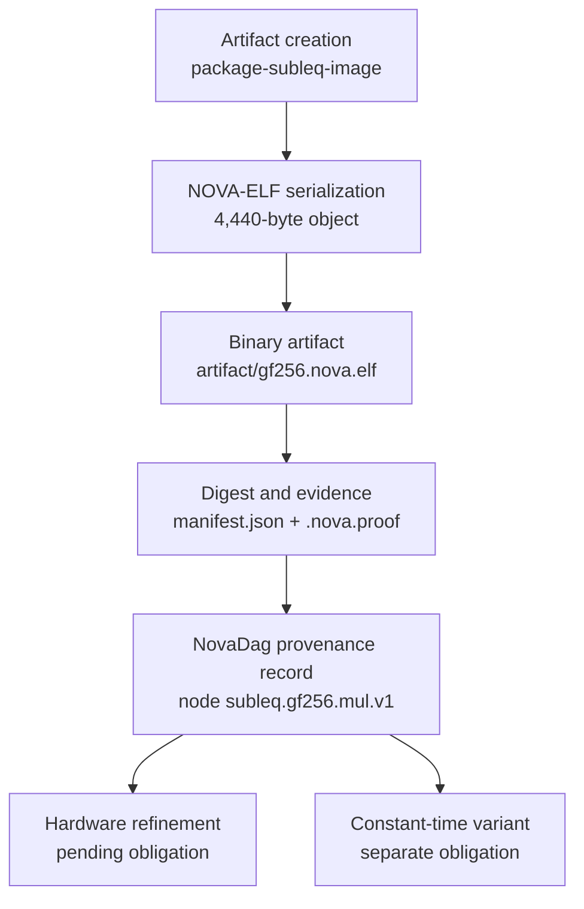

The `.nova.dag` section is the seam. It carries the node id and the parent id inside the object, so the object names its own lineage. But the section does not create the node: NovaDag creates the node when it ingests the manifest, and the manifest is the ingestion input, not the section. The section is a convenience for a reader holding the object; the manifest is the record the DAG actually consumes. If the two disagreed, the manifest would be authoritative for the DAG and the section would be wrong — the section is a copy of the lineage claim, not its source.

The separation exists because the two systems change for different reasons. The format changes when the serialization needs change (a new section, a new encoding, a new word width). The DAG changes when the provenance needs change (a new transformation, a new parent, a new obligation). A format change should not require a DAG migration, and a DAG change should not require a format revision. The `.nova.dag` section and the manifest are the narrow interface between them: a node id, a parent id, a schema name, and a set of digests. Everything else is internal to one side or the other.

The NovaDag side of the relationship, as recorded in the DAG node for `subleq.gf256.mul.v1`, is: the parent is `cryptol.gf256.mul.v1` (the Cryptol specification), the status is `proved` within the tested machine model, and the pending obligations are machine word width, memory aliasing, instruction decoding, termination, memory bounds, RTL refinement, and constant-time behavior. This repository does not track those obligations; it produces the artifact they are obligations about.

## Error handling

Errors in this project are Racket errors: raised exceptions with a symbol identifying the raiser and a message. There is no error-return convention, no result type, and no recovery path. A caller that wants to handle errors uses Racket's `with-handlers`.

| Condition | Raised by | Message |
|---|---|---|
| Input shorter than 64 bytes, or bad magic | `nova-elf-read` | `"not an ELF file"` |
| `EI_CLASS` is not 2 | `nova-elf-read` | `"not ELF64"` |
| `EI_DATA` is not 1 | `nova-elf-read` | `"not little-endian"` |
| `e_machine` is not `0xFF01` | `nova-elf-read` | `"not a NOVA-ELF (e_machine=...)"` |
| Missing `.nova.text` or `.nova.data` | `load-subleq-image` (via `hash-ref`) | Racket hash error: no value found for key |
| Section offset/size out of range | Racket `subbytes` (via `nova-elf-read`) | Racket contract error on out-of-range slice |
| Section header index out of range | Racket `list-ref` (via `nova-elf-read`) | Racket contract error |
| Cell outside 32-bit signed range | `cells->bytes` (via `integer->integer-bytes`) | Racket contract error on out-of-range integer |
| Odd-length hex string | `nova-hex16-decode` | `"odd-length hex string"` |
| Non-hex character | `nova-hex16-decode` | `"bad hex digit: ..."` |
| Non-alphabet character in BASE32 | `nova-base32-decode` | `"bad base32 char: ..."` |
| Non-alphabet character in BASE512 | `nova-base512-decode` | `"bad base512 char"` |
| Nonzero padding bit in BASE512 | `nova-base512-decode` | `"nonzero padding bit"` |
| Malformed BASE64 | `nova-base64-decode` (via `net/base64`) | Racket base64 error |
| Bad ROMHEX line (not 2 parts) | `nova-romhex-decode` | `"bad line: ..."` |
| Bad hex in a ROMHEX line | `nova-romhex-decode` | `"bad hex in line: ..."` |
| Failed verification check | `check` (via `verify.rkt`) | `"FAIL <name>: got ..., want ..."` |
| Missing sibling module | Racket `require` | `"cannot open module file"` |

Two error properties are worth noting. First, the reader's errors are all raised before or during parsing, never after a partial result is returned — `nova-elf-read` either returns the complete hash or raises. Second, the verification script's `check` raises on the first failure and stops, so a failing run prints the passing checks before the failure and nothing after it. The output of a failed run is therefore a prefix of the passing output, followed by the failure message.

## Security considerations

This section states the trust boundary of the parser and the encoding layer, what is protected, and what is assumed. It does not speculate about vulnerabilities or exploitability; it describes the implemented behavior and the input assumptions.

### Parser trust boundary

`nova-elf-read` is a parser for a binary format, and binary parsers are the trust boundary of any system that accepts files. The reader's implemented defenses are:

- **Magic, class, data encoding, and machine identifier are checked before any section data is read.** A file that is not a little-endian ELF64 object for machine `0xFF01` is rejected before the reader indexes into the section headers.
- **Section contents are sliced, not trusted.** The reader takes the offset and size from the section headers and extracts exactly those bytes. It does not follow pointers inside the section contents.
- **Out-of-range accesses raise.** Racket's `subbytes` and `list-ref` raise errors on out-of-range indices, so a file whose headers point outside the file produces an exception rather than a fabricated section.

The reader's known limitations are:

- **No bounds validation before slicing.** The reader does not check that `e_shoff`, `e_shnum`, `e_shstrndx`, or any section's offset and size are within the file before using them. The runtime catches the violation, but the error is a Racket contract error, not a descriptive validation error.
- **No validation of `e_type`, `e_version`, `e_entry`, `e_flags`, or the header sizes.** A file with inconsistent values in those fields is accepted.
- **No duplicate-name detection.** Two sections with the same name in the string table collapse to one entry in the hash, the later one winning.
- **No section-size sanity checks.** A `.nova.text` whose size is not a multiple of 4 is accepted by the reader and fails later in the loader.
- **No digest verification on load.** The loader does not compare the loaded image against the image digest in `.nova.proof` or `.nova.urom`. A file whose section contents were altered after packaging would load without complaint, as long as the headers still parse. Integrity checking is the caller's responsibility: compare the SHA-256 of the reconstructed image against the recorded image digest.

### Input assumptions

The format is designed for artifacts produced by `package-subleq-image` and consumed by `load-subleq-image` or by the VHDL ROM loader, in a pipeline the artifact owner controls. The implemented assumptions are:

- The producer is honest. The `.nova.proof` and `.nova.dag` sections are assertions by the packager, not independently verified claims.
- The file is complete. Truncation is detected only when a header or section slice runs past the end of the file, and the detection is a runtime error.
- The machine identifier is the gate. A file with `e_machine` `0xFF01` is treated as a NOVA-ELF object; anything else is rejected.
- Cell values fit in 32-bit signed. Serialization raises rather than wraps, so a violation is loud.

### Encoding layer

- **Encodings provide no confidentiality.** A custom alphabet is a representation change, not encryption. The alphabets are public and documented. Anyone holding an encoded artifact can decode it with the functions in this repository.
- **Decoders reject invalid input loudly.** Every decoder raises on characters outside its alphabet, and BASE512 additionally verifies its padding bits. BASE32 decoding drops sub-byte tail bits, so two different strings can decode to the same bytes — that is a property of the decoder, not a collision to exploit, and it is documented in the codec chapter.
- **ROMHEX decoding fills missing addresses with zero.** A sparse ROMHEX file and a dense file with explicit zeros decode identically. A producer that omits an address is asserting that the address holds zero.
- **The identity digest is over the binary image.** Changing an encoding does not change the identity, and changing the image changes the identity. The digest is the integrity anchor; the encodings are not.

## Interoperability

NOVA-ELF interoperates with generic ELF tooling at the header and section-table level, and with nothing else at the generic level. That is the intended boundary.

**What generic tools can do.** Any tool that parses ELF64 can read the header, list the ten sections with their offsets and sizes, and dump the section contents as bytes. `readelf -h` and `readelf -S` work. A hex editor works. A script that reads ELF section headers works. The section names are human-readable in `.shstrtab`, and the note in `.note.nova` is a standard ELF note that generic note readers can parse.

**What generic tools cannot do.** No generic tool knows what `.nova.text` means, what `e_machine` `0xFF01` is, or how to reconstruct a machine image from the sections. No generic tool can execute the object, link it, or load it — there are no program headers, no relocations, and no symbols. The object is relocatable in the ELF sense only: it is a container for sections, not a linkable unit for a real processor. Any tool that tries to treat it as one will fail at the machine identifier, which is the point.

**What a compatible implementation needs.** A loader in another language needs: the header layout from the table in [The ELF64 container](#the-elf64-container); the section header layout; the name resolution through `.shstrtab`; the little-endian 32-bit signed decoding of `.nova.text` and `.nova.data`; the concatenation order (text first, then data); and the machine identifier check. That is the whole loader. Everything else in the object is metadata that a minimal loader can ignore. The [Loader and parser](#loader-and-parser) chapter and the worked examples give the exact semantics; the Racket reader is the reference implementation.

**What a compatible serializer needs.** A serializer needs the same tables in reverse: the fixed header values, the section order, the alignment rules (contents 8-byte aligned after the header for the table, each section padded to its own alignment), the `.shstrtab` construction (leading NUL, NUL-terminated names in the fixed order), and the section header fields (including the four that are always zero). A serializer that produces different section offsets but the same contents produces a different file with the same image digest, and the loader accepts it — the loader resolves by name and reads offsets from the headers, so layout freedom is built in.

## Format extensibility and compatibility

NOVA-ELF is version 1, and this manual documents version 1 only. There is no version roadmap in this repository, and none is invented here. What follows is the version strategy that the implementation establishes, and the compatibility rules that follow from it.

### Version identification

The format version is recorded in three places, and they agree:

- The constant `NOVA-ELF-VERSION` in `elf/elf.rkt`, value `1`.
- The `.note.nova` description string, which begins `NOVA-ELF v1`.
- The `.nova.codec` content, `NOVA-BASE256 v1`, and the manifest's `elf.version` field, `"NOVA-ELF v1"`.

A reader that needs to distinguish versions should read the `.note.nova` description or the `NOVA-ELF-VERSION` constant, not the machine identifier. The machine identifier `0xFF01` identifies the target (SUBLEQ), not the version; a future version of the format for the same target would need a version field to distinguish itself, and `.note.nova` is where that field lives.

### Stable fields

These fields are stable by construction — a compatible loader can rely on them:

- The ELF magic, class (2), and data encoding (1).
- `e_type` 1, `e_version` 1, `e_ehsize` 64, `e_shentsize` 64.
- The section names and their order in the writer's output.
- The `.note.nova` layout: namesz, descsz, type, name, description, each padded to 4.
- The `.nova.urom` layout: version, digest, four dispatch words.
- The 32-bit signed little-endian word encoding.
- The concatenation order: `.nova.text` then `.nova.data`.

### What a future version could change

A future version could add sections, add note types, extend the `.nova.urom` descriptor with more dispatch words, or record a different codec identifier in `.nova.codec`. It could not change the header layout, the word width, the endianness, or the meaning of the existing sections without breaking compatibility with v1 loaders — and a loader that encountered an unknown section should ignore it (the reader already does: it places every section in the hash by name, and the loader reads only the two it needs). Unknown sections are therefore forward-compatible by construction: a v1 loader reading a v2 file with extra sections returns the sections it knows and ignores the rest, as long as the two sections it needs are present and unchanged.

### Round-trip compatibility

Any file the v1 writer produces, the v1 reader accepts, and the loader reconstructs exactly. That is the round-trip contract, and it is checked for the v1 image. A file produced by a different serializer that follows the tables in this manual is accepted by the v1 reader if the header checks pass and the two required sections are present. A file produced by a future version is accepted by the v1 reader if the header checks pass — the reader does not check the version — but the loader's reconstruction would only be correct if the future version preserved the v1 section semantics. Version detection is the reader's responsibility, and the current reader does not perform it: it checks the machine identifier, not the version. That is a documented limitation, not an oversight to be fixed silently; any future version must either preserve the v1 section semantics or change the machine identifier.

## Repository layout

The directory tree below is the actual tracked file list (`git ls-files`), with one line per file and no fabricated entries.

```
nova-elf/
  LICENSE
  README.md
  STATUS.md
  artifact/
    gf256.nova.b64
    gf256.nova.elf
    gf256.nova.hex16
    gf256.nova.romhex
    manifest.json
  docs/
    svg/
      codec-transformation.svg
      nova-architecture.svg
      nova-elf-layout.svg
      subleq-datapath.svg
      verification-pipeline.svg
  elf/
    codec.rkt
    elf.rkt
    package.rkt
    verify.rkt
```

| Path | Responsibility |
|---|---|
| `LICENSE` | SNAPKITTY OPAQUE SOURCE LICENSE v1.0. |
| `README.md` | This manual. |
| `STATUS.md` | Verification scope and open items, as plain facts. |
| `artifact/gf256.nova.elf` | The v1 NOVA-ELF object, 4,440 bytes. |
| `artifact/gf256.nova.romhex` | ROM initialization for the 731-cell image, 731 lines. |
| `artifact/gf256.nova.hex16` | HEX16 encoding of the ELF, 8,880 bytes. |
| `artifact/gf256.nova.b64` | BASE64 encoding of the ELF, 5,920 bytes. |
| `artifact/manifest.json` | Digests, sizes, lineage, and proof summary for the v1 artifact. |
| `docs/svg/*.svg` | The five architecture diagrams embedded in this manual. |
| `elf/elf.rkt` | NOVA-ELF v1 writer and parser. |
| `elf/codec.rkt` | The six base encodings. |
| `elf/package.rkt` | Image to ELF object, ELF object to image. |
| `elf/verify.rkt` | The verification contract, run by execution. |

There are no tests beyond `verify.rkt`, no build scripts, no shell scripts, and no examples directory. The verification script is the test suite. The machine, assembler, and lowering engine are outside this repository, in the sibling trees `subleq-isa-racket` and `subleq-lowering`, which the packaging and verification modules require by relative path.

## Architectural tradeoffs

Each decision below is stated with its reason, and the text distinguishes decisions the implementation establishes from rationale the author infers. Where the source does not state a reason, the rationale is labeled as inferred.

**ELF64 as the container (established by the implementation).** The writer produces a well-formed ELF64 object with a standard header, section table, and string table. The benefit is reuse: framing, alignment, and metadata conventions come from ELF, and generic tools can inspect the file. The cost is 64 bytes of header plus 640 bytes of section headers plus 102 bytes of string table for a 4,440-byte file — about 18 percent overhead — and a format that a reader must parse rather than read linearly. The tradeoff favors inspectability and tooling over compactness, which is the right call for an artifact format whose purpose is to be checked.

**A 32-bit signed machine word (established by the implementation and the ABI note).** The machine's cells are serialized as 32-bit signed little-endian words. The benefit is that the image is compact (2,924 bytes for 731 cells) and the word width matches the values the program actually uses (-1..729). The cost is that the format cannot represent a program whose values exceed the 32-bit range, and the reference machine's unbounded integers are not fully serializable. The tradeoff is acceptable for this image and is recorded as an ABI term so that a future image with larger values fails loudly at serialization rather than silently.

**Word-addressed memory (established by the machine model).** Addresses count words, not bytes. The benefit is that the machine model is simple — the program counter advances by 3 per instruction, and addresses are small numbers. The cost is a conversion step whenever the format touches byte-oriented structures (ELF offsets, ROMHEX lines are word-addressed so the hardware side avoids the conversion). The tradeoff is inherent to the machine, not a format choice.

**SUBLEQ triples (established by the machine model).** One instruction, three cells. The benefit is a minimal machine with a trivially documented semantics, which makes the exhaustive verification feasible: the whole computer is one transition function. The cost is program size — 235 triples for a single multiplication — and data-dependent step counts that rule out constant-time behavior in this form. The tradeoff is the project's premise, not a decision to revisit.

**Racket for serialization and parsing (established by the implementation).** The writer, parser, codecs, and verifier are Racket. The benefit is that the same language expresses the machine model, the assembler, the lowering engine, and the format, so the verification script can load the image, package it, load it back, and execute it in one process. The cost is that running the verification requires Racket and the sibling trees, and that the reference implementation is not the language a hardware engineer would choose for a ROM loader. The tradeoff favors a single-language verification loop over a multi-language toolchain.

**A dedicated loader (established by the implementation).** The object loads only through `nova-elf-read`, never through the operating system. The benefit is that the loader enforces the machine identifier and understands the section semantics. The cost is that the object is opaque to every other loader. The tradeoff is deliberate: the object is not a native binary and must not be treated as one.

**Custom sections (established by the implementation).** Eight sections with fixed names, types, flags, and alignments. The benefit is that each concern has its own place — code, data, constants, descriptor, evidence, encoding, lineage, version — and a reader can ignore the sections it does not need. The cost is the section header table and the string table. The tradeoff favors explicitness over compactness.

**Multiple reversible encodings (established by the implementation).** Six codecs for the same bytes. The benefit is that each channel gets the encoding it needs: HEX16 for inspection, BASE64 for transport, ROMHEX for hardware, BASE256 for canonicity, BASE32 and BASE512 for experiments. The cost is six implementations to maintain and six contracts to check. The tradeoff is justified by the bijectivity checks, which are cheap to run and cover all six.

**ROMHEX (established by the implementation).** A word-addressed, line-oriented text format. The benefit is that a ROM loader can read it line by line without parsing ELF. The cost is the largest expansion of any encoding (13,158 bytes for a 2,924-byte image) and a decoder with fill and overwrite semantics that must be understood. The tradeoff favors the hardware consumer over the file size.

**Verification contracts (established by the implementation).** Checks run by execution, recorded as `ok` lines, with the strongest check being exhaustive over the input domain. The benefit is that the claims are reproducible by anyone with Racket. The cost is that execution checks are not proofs, and the manual must keep saying so. The tradeoff is honest: the project claims what it checked, and labels what it did not.

**Provenance separation (established by the implementation and the repository layout).** The format tooling lives here; the DAG lives in NovaDag. The benefit is that each system changes independently. The cost is the seam — the `.nova.dag` section and the manifest must agree, and nothing in either repository enforces that agreement automatically. The tradeoff is accepted because the alternative (a format that knows about DAG internals, or a DAG that knows about ELF internals) couples two systems that have no business being coupled.

## Developer guide

### Setting up

1. Clone the repository.
2. Install Racket v8.15 (or confirm the version at your Racket installation with `racket --version`).
3. For the format and codec modules only, no further setup is needed. For packaging and verification, place the sibling trees `subleq-isa-racket` and `subleq-lowering` inside the repository root, or point the relative requires at them — see [Reproducing the project checks](#reproducing-the-project-checks).

### Making a change

- **Changing a section.** Edit the section list in `package-subleq-image` and the `SECTION-NAMES` list in `elf.rkt` together, then re-run `verify.rkt` and confirm the artifact hashes change as expected. A section added to one list and not the other produces a file whose string table and headers disagree.
- **Changing a codec.** Edit `elf/codec.rkt`, add or update the corresponding `check` in `verify.rkt`, and re-run. A codec change that breaks bijectivity fails loudly on the 256-byte test input.
- **Changing the word width.** The width is recorded in the `.note.nova` description string, in `cells->bytes`, in `load-subleq-image`'s byte-to-cell conversion, and in the ROMHEX value formatting. All four must change together, and the ABI note must be updated to say so. The v1 image would need re-verification.
- **Adding a dispatch word.** Extend the `.nova.urom` construction in `package-subleq-image` and the controller that consumes it, together. The section size grows by 4 bytes per word, and the file layout shifts accordingly.

### What not to change

- Do not change the machine identifier `0xFF01` without also changing the reader's check and the documentation. A writer and reader that disagree on the identifier produce files the reader rejects.
- Do not change the section order in `SECTION-NAMES` without changing the writer's layout expectations. The reader resolves by name and tolerates reordering, but the shipped layout table in this manual would be wrong.
- Do not edit the artifacts by hand. They are outputs of `verify.rkt`; regenerate them by running the script.
- Do not edit `manifest.json` by hand to match a changed artifact. The manifest is an authored record; if the artifact changes, the manifest's digests must be recomputed from the new artifact and the provenance re-established.

## Troubleshooting

**`racket elf/verify.rkt` fails with "cannot open module file" for `subleq-isa-racket/subleq/machine.rkt`.**
The sibling trees are not in place. The requires in `elf/package.rkt` resolve to `subleq-isa-racket/` and `subleq-lowering/` inside the repository root. Place them there (or symlink them, as in the reproduction procedure) and re-run. The codec and ELF modules do not need the siblings.

**`nova-elf-read` raises "not an ELF file".**
The input is shorter than 64 bytes or does not start with the ELF magic. Check that the file was transferred in binary mode — a text-mode transfer can corrupt the file — and that the path points at an ELF file, not at a HEX16 or BASE64 encoding of one. Decode first, then read.

**`nova-elf-read` raises "not a NOVA-ELF (e_machine=...)".**
The file is an ELF object for a different machine. The value in the message is the actual `e_machine`. If it is a standard machine (for example 62 for x86-64), the file is not a NOVA-ELF object at all. If it is `0xFF01` in a different byte order, the file's endianness is wrong.

**`load-subleq-image` raises a hash error for `.nova.text` or `.nova.data`.**
The object is missing a required section. The writer always produces both; a hand-built or truncated object may lack one. Inspect the section list with `nova-elf-read` and `hash-keys` to see what is present.

**`check` raises "FAIL ELF loader preserves image".**
The reconstructed image differs from the original. Compare the two lists cell by cell to find the first difference; the usual cause is a section that was edited after packaging, or a section size that is not a multiple of 4.

**`check` raises "FAIL GF semantics preserved through ELF".**
The loaded image computes a wrong product for some input pair. The failure message gives the mismatch count, not the pair. Re-run the exhaustive loop manually (as in [Detailed usage examples](#detailed-usage-examples)) and record the first failing pair, then check whether the loaded image differs from the original — a packaging error and a machine error look the same from this check alone, and the round-trip check distinguishes them.

**The regenerated artifacts have different hashes from the shipped ones.**
The inputs changed: the proof or DAG JSON strings, the image, or the section construction. The hashes are sensitive to every byte. Diff the regenerated ELF against the shipped one section by section to find what changed; the section headers give the offsets.

**A ROMHEX file decodes to more cells than expected.**
The decoder fills missing addresses with zero up to the maximum address present. A file with a stray high address (for example a typo that turns `000002c6` into `00002c6` with a missing digit) produces a long zero-filled list. Check the maximum address in the file first.

## Glossary

| Term | Meaning |
|---|---|
| Canonical binary image | The 731 cells serialized as 32-bit signed little-endian words (2,924 bytes). The image digest is over these bytes. |
| Cell | One memory word of the SUBLEQ machine: an exact integer in the reference machine, a 32-bit signed value in the file. |
| Code cells | The first 705 cells of the image: the program, 235 SUBLEQ triples. |
| Data cells | The last 26 cells of the image: inputs, outputs, scratch, and constants. |
| Dispatch word | One of the four 32-bit words in `.nova.urom` that program the outer ROM controller. |
| ELF64 | The 64-bit Executable and Linkable Format. The container of this project. |
| `EM_NOVA_SUBLEQ` | The machine identifier `0xFF01`, unregistered, v1 only, in the processor-specific reserved range. |
| `ET_REL` | Relocatable object file. The `e_type` of every NOVA-ELF object. |
| Exhaustive check | A check run over the full input domain (all 256 byte values; all 65,536 input pairs). |
| `gf-mul-ref` | The reference GF(2^8) multiplication function from the lowering engine, used as the oracle in the semantics check. |
| Image digest | SHA-256 over the canonical binary image: `153be573...`. The identity of the microcode. |
| `in-a`, `in-b`, `out-r` | Labels for the input and output cells, at word addresses 705, 706, and 707. |
| Manifest | `artifact/manifest.json`: digests, sizes, lineage, and proof summary for the v1 artifact. |
| Microprogram descriptor | The 52-byte `.nova.urom` content: version, manifest digest, dispatch words. |
| NOVA-ELF | This format: a SUBLEQ machine image packaged as an ELF64 relocatable object. |
| ROMHEX | The word-addressed ROM initialization encoding: one `ADDR VALUE` line per word. |
| Round trip | Encoding then decoding (or packaging then loading) returning the original input exactly. |
| Sampled check | A check run over a subset of the input domain. The execution value range is the only sampled measurement in this manual. |
| Section | A named byte range in the ELF file, described by a section header. |
| `.shstrtab` | The section name string table: NUL-separated section names. |
| SUBLEQ | Subtract and branch if less or equal: the one-instruction machine of this project. |
| Triple | One SUBLEQ instruction: three cells `(a, b, c)`. |
| Word address | An index into the 65,536-cell machine memory. Distinct from a byte offset in the ELF file. |

## License and acknowledgments

NOVA-ELF is distributed under the SNAPKITTY OPAQUE SOURCE LICENSE v1.0 (SPDX `LicenseRef-Sovereign-Leviathan-SL-AGPL3-001`, Copyright © 2026 SnapKitty West). The full text is in `LICENSE`. The license governs the source and artifacts in this repository; it is not an open-source license in the conventional sense, and the terms in `LICENSE` are authoritative.

The SUBLEQ machine model, assembler, and GF(2^8) lowering engine live outside this repository, in the `subleq-isa-racket` and `subleq-lowering` trees, and are documented here because the format exists to carry their output. The outer ROM controller that consumes `.nova.urom` and the NovaDag provenance system that records the artifact are separate projects; their verification is theirs, and this manual records the boundary rather than claiming their results.

The v1 artifact — the 731-cell GF(2^8) multiplication image, its 4,440-byte ELF object, and its encodings — is the shipped instance of the format. The verification results reported here were reproduced against the current tree on 2026-11-20 with Racket v8.15. The image digest is `153be573ab87f6a62f9c102cef88ee1a4e0ccfb501115c5e0ed0f8fa454ca673`; the ELF digest is `4c2605a56c05fab29b5f80e6244a84791b5db7a2021511203c0b6d6b4b79057f`.
